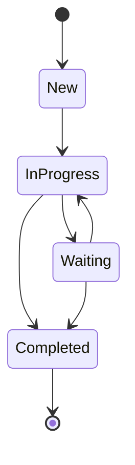
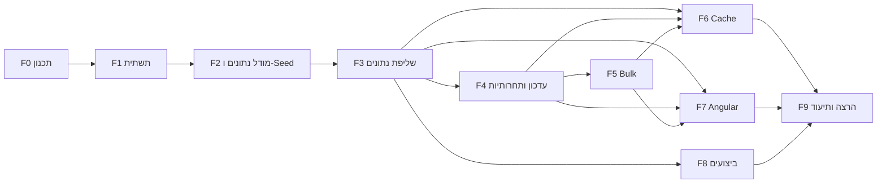
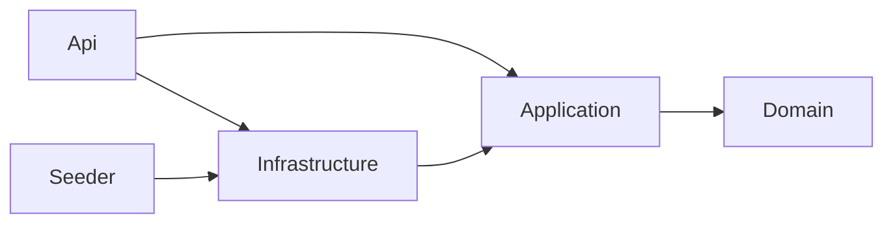

# Requests Management System

מערכת Full Stack לניהול פניות ובקשות המתקבלות מארגונים ומעסיקים.
המערכת מיועדת לעבודה של מספר משתמשים במקביל מול כמות גדולה של פניות (100,000+), ומאפשרת לאתר, לסנן, למיין ולדפדף בפניות. כל הפעולות האלה מתבצעות בצד השרת. בנוסף אפשר לעדכן סטטוס עם הגנה מפני עדכונים מתחרים, לבצע עדכון מרובה (Bulk), לצפות בהיסטוריית שינויים ולצפות בנתונים מסכמים.

**טכנולוגיות:** ASP.NET Core 10 · EF Core 10 · SQL Server 2022 · Angular 20 · xUnit · Testcontainers · Docker

## התחלה מהירה

נדרש רק Docker Desktop:

```bash
cp .env.example .env
docker compose up --build
```

הפקודה מרימה את כל המערכת. הריצה הראשונה לוקחת כמה דקות, בגלל הורדת ה-Images והבנייה. השירותים עולים בסדר הבא:

1. **SQL Server:** ממתין עד שה-Healthcheck שלו עובר.
2. **Seeder:** מחיל את ה-Migrations, יוצר 100,000 פניות ומסתיים.
3. **API:** עולה רק אחרי שה-Seeder הסתיים בהצלחה.
4. **צד הלקוח:** ‏nginx שמגיש את האפליקציה, ומעביר את `/api` ל-API.

| כתובת | מה יש שם |
|---|---|
| http://localhost:8080 | האפליקציה |
| http://localhost:5000/scalar | תיעוד ה-API ובדיקה ידנית של ה-Endpoints |
| `localhost,1433` | ‏SQL Server: משתמש `sa`, הסיסמה מקובץ `.env`, ‏DB בשם `RequestsManagement` |

ההוראות להרצה בלי Docker, לבדיקות ולצפייה בלוגים נמצאות בפרק [הרצה מקומית](#הרצה-מקומית).

> **שימו לב:** ב-Windows, ‏`docker compose build` נכשל כשנתיב התיקייה מכיל תווים שאינם ASCII, למשל עברית. זו מגבלה ידועה של BuildKit. מומלץ לשכפל את הריפו לנתיב באנגלית בלבד.

---

## תוכן עניינים

1. [סטטוס התקדמות](#סטטוס-התקדמות)
2. [אפיון המערכת](#אפיון-המערכת)
   - [מבנה פנייה](#מבנה-פנייה)
   - [מחזור חיים של פנייה - מעברי סטטוס](#מחזור-חיים-של-פנייה---מעברי-סטטוס)
   - [היסטוריית שינויים](#היסטוריית-שינויים)
   - [חוזה ה-API](#חוזה-ה-api)
   - [קודי תשובה](#קודי-תשובה)
3. [תכנון עבודה וחלוקה למשימות](#תכנון-עבודה-וחלוקה-למשימות)
   - [מתודולוגיה](#מתודולוגיה)
   - [פירוק ל-Features, User Stories ו-Tasks](#פירוק-ל-features-user-stories-ו-tasks)
   - [סדר ביצוע ותלויות](#סדר-ביצוע-ותלויות)
   - [סיכום הערכת מאמץ](#סיכום-הערכת-מאמץ)
   - [מיפוי דרישות המבדק למשימות](#מיפוי-דרישות-המבדק-למשימות)
4. [טכנולוגיות וגרסאות](#טכנולוגיות-וגרסאות)
5. [מבנה הפתרון](#מבנה-הפתרון)
   - [שכבות וכיווני תלות](#שכבות-וכיווני-תלות)
   - [קונבנציות ואיכות קוד](#קונבנציות-ואיכות-קוד)
6. [בסיס הנתונים](#בסיס-הנתונים)
   - [סכמה](#סכמה)
   - [אינדקסים](#אינדקסים)
   - [נתוני בדיקה (Seed)](#נתוני-בדיקה-seed)
7. [API לשליפת נתונים](#api-לשליפת-נתונים)
   - [מניעת טעינת כלל הנתונים לזיכרון](#מניעת-טעינת-כלל-הנתונים-לזיכרון)
   - [תמיכת האינדקסים בתרחישי החיפוש והסינון](#תמיכת-האינדקסים-בתרחישי-החיפוש-והסינון)
   - [Validation, שגיאות ו-Logging](#validation-שגיאות-ו-logging)
8. [עדכון סטטוס, Concurrency והיסטוריה](#עדכון-סטטוס-concurrency-והיסטוריה)
   - [מניעת Lost Update](#מניעת-lost-update)
   - [היסטוריית שינויים (Audit)](#היסטוריית-שינויים-audit)
   - [עדכון מרובה (Bulk)](#עדכון-מרובה-bulk)
9. [Cache](#cache)
10. [צד לקוח (Angular)](#צד-לקוח-angular)
11. [ביצועים](#ביצועים)
12. [בדיקות אוטומטיות](#בדיקות-אוטומטיות)
13. [החלטות טכנולוגיות וחלופות שנשקלו](#החלטות-טכנולוגיות-וחלופות-שנשקלו)
14. [מגבלות ידועות ושיפורים אפשריים](#מגבלות-ידועות-ושיפורים-אפשריים)
15. [שימוש בכלי AI](#שימוש-בכלי-ai)
16. [הרצה מקומית](#הרצה-מקומית)

---

## סטטוס התקדמות

כל שלב מסתיים בקומיט נפרד ובעדכון של המסמך הזה.

| שלב | תוכן | סטטוס |
|---|---|---|
| 0 | תכנון, אפיון וחלוקה למשימות | הושלם |
| 1 | תשתית Solution וקונבנציות | הושלם |
| 2 | מודל נתונים, אינדקסים ו-Seed של 100K רשומות | הושלם |
| 3 | API לשליפת נתונים ו-Aggregations | הושלם |
| 4 | עדכון סטטוס, Concurrency והיסטוריית שינויים | הושלם |
| 5 | עדכון מרובה (Bulk) | הושלם |
| 6 | Cache | הושלם |
| 7 | צד לקוח (Angular) | הושלם |
| 8 | מדידת ביצועים | הושלם |
| 9 | היערכות להרצה ותיעוד סופי | הושלם |

---

## אפיון המערכת

### מבנה פנייה

| שדה | טיפוס | הערות |
|---|---|---|
| `Id` | `int` | מזהה ייחודי (Identity, מפתח ראשי Clustered) |
| `Title` | `nvarchar(200)` | כותרת הפנייה, חובה |
| `OrganizationName` | `nvarchar(150)` | שם הארגון או העסק, חובה |
| `Status` | `tinyint` (enum) | `New`, `InProgress`, `Waiting`, `Completed` |
| `Priority` | `tinyint` (enum) | `Low`, `Medium`, `High` |
| `AssignedTo` | `nvarchar(100)` | מזהה או שם המטפל, יכול להיות ריק |
| `CreatedAt` | `datetime2` | תאריך יצירה (UTC) |
| `UpdatedAt` | `datetime2` | תאריך עדכון אחרון (UTC), מתעדכן בכל שינוי |
| `RowVersion` | `rowversion` | מנוהל על ידי SQL Server ומשמש לזיהוי עדכון מתחרה |

ה-enums נשמרים כמספרים: זה חוסך מקום באינדקסים ומייעל השוואות. ב-API הם נחשפים כמחרוזות קריאות.

### מחזור חיים של פנייה - מעברי סטטוס

מעברי הסטטוס מוגדרים במפורש כמכונת מצבים בשכבת ה-Domain. מעבר שאינו מופיע בטבלה נדחה עם שגיאת Validation ברורה.



| מסטטוס | סטטוסים מותרים |
|---|---|
| `New` | `InProgress` |
| `InProgress` | `Waiting`, `Completed` |
| `Waiting` | `InProgress`, `Completed` |
| `Completed` | אין, זהו סטטוס סופי |

הנימוק: פנייה חדשה חייבת לעבור טיפול לפני שהיא מסומנת כהושלמה, ופנייה שהושלמה לא נפתחת מחדש. פתיחה מחדש היא תהליך עסקי נפרד שאינו חלק מהאפיון.

### היסטוריית שינויים

לכל שינוי סטטוס נשמרת רשומת Audit בטבלה `RequestStatusHistory`:

| שדה | תיאור |
|---|---|
| `Id` | מזהה רשומה |
| `RequestId` | מפתח זר לפנייה |
| `PreviousStatus` | הסטטוס לפני השינוי |
| `NewStatus` | הסטטוס אחרי השינוי |
| `ChangedAt` | מועד השינוי (UTC) |
| `ChangedBy` | מזהה המשתמש שביצע את השינוי |

רשומת ה-Audit נכתבת **באותה טרנזקציה** של עדכון הפנייה. לכן לא ייתכן מצב של שינוי בלי היסטוריה, וגם לא מצב של היסטוריה בלי שינוי.

### חוזה ה-API

| Method | Route | תיאור |
|---|---|---|
| `GET` | `/api/requests` | שליפת פניות עם דפדוף, סינון, חיפוש ומיון בצד השרת |
| `GET` | `/api/requests/{id}` | שליפת פנייה בודדת |
| `GET` | `/api/requests/summary` | נתונים מסכמים: התפלגות לפי סטטוס ולפי עדיפות (נשמר ב-Cache) |
| `PATCH` | `/api/requests/{id}/status` | עדכון סטטוס של פנייה בודדת |
| `PATCH` | `/api/requests/status` | עדכון סטטוס מרובה, עד 100 פניות |
| `GET` | `/api/requests/{id}/history` | היסטוריית שינויי הסטטוס של פנייה |
| `GET` | `/api/requests/status-transitions` | מפת מעברי הסטטוס המותרים, לשימוש צד הלקוח |

**פרמטרים לשליפה (`GET /api/requests`):**

| פרמטר | תיאור |
|---|---|
| `page`, `pageSize` | דפדוף. ל-`pageSize` יש ערך מקסימלי שמוגדר בקונפיגורציה |
| `status`, `priority` | סינון. אפשר להעביר כמה ערכים |
| `organizationName`, `assignedTo` | סינון לפי ערך מדויק |
| `createdFrom`, `createdTo` | טווח תאריכי יצירה |
| `search` | חיפוש טקסטואלי ב-`Title` וב-`OrganizationName` |
| `sortBy`, `sortDirection` | מיון לפי `CreatedAt`, `UpdatedAt`, `Priority`, `Status`, `Title` או `OrganizationName`, בכיוון `Asc` או `Desc` |

**זיהוי המשתמש המבצע:** לא נדרש מנגנון הזדהות, ולכן בפעולות עדכון המשתמש מזוהה באמצעות Header חובה ‏`X-User-Id`. ה-Header נקרא רק בשכבת ה-Api ומועבר לשירות כפרמטר, כך שמעבר ל-Claims של JWT ישנה רק את ה-Controller.

**הגנה מפני עדכון מתחרה:** כל פנייה מוחזרת ללקוח עם שדה `version`, שהוא ה-`RowVersion` מקודד ב-Base64. בבקשת עדכון הלקוח מחזיר את הגרסה שבידיו, והעדכון מתבצע רק אם הגרסה ב-DB זהה לה.

### קודי תשובה

| מצב | קוד |
|---|---|
| הצלחה | `200 OK` |
| פרמטרים לא תקינים או סטטוס לא קיים | `400 Bad Request` (`ValidationProblemDetails`) |
| פנייה לא קיימת | `404 Not Found` |
| עדכון מתחרה: הגרסה שנשלחה אינה עדכנית | `409 Conflict` |
| מעבר סטטוס אסור | `422 Unprocessable Entity` |
| שגיאה לא צפויה | `500 Internal Server Error` (ללא חשיפת פרטים פנימיים) |

כל השגיאות מוחזרות בפורמט ProblemDetails אחיד (RFC 9457).
הקוד `409` שמור לתחרותיות בלבד, כדי שהלקוח יוכל להגיב לו באופן חד-משמעי: לטעון את הגרסה העדכנית ולהציע למשתמש לנסות שוב.

---

## תכנון עבודה וחלוקה למשימות

### מתודולוגיה

האפיון פורק להיררכיה של שלוש רמות:

- **Feature:** יחידת ערך עסקית או טכנית, שממופה לסעיף או לסעיפים במבדק.
- **User Story:** הצורך מנקודת מבט המשתמש או הבודק.
- **Task:** יחידת עבודה ברת ביצוע, עם תוצר מוגדר והערכת מאמץ בדקות.

כל Feature מסתיים בקומיט ייעודי שכולל את הקוד, את הבדיקות ואת עדכון התיעוד שלו. הבדיקות האוטומטיות נכתבות יחד עם הפיצ'ר ולא בסוף הפרויקט, כך שכל שלב נמסר כשהוא כבר מאומת.

### פירוק ל-Features, User Stories ו-Tasks

#### F0 - תכנון ואפיון
> **US0:** כבודק/ת, אני רוצה לראות כיצד האפיון תורגם לתוכנית עבודה מסודרת.

| ID | משימה | מה נדרש | תוצר | תלוי ב- | הערכה |
|---|---|---|---|---|---|
| T0.1 | ניתוח דרישות ואפיון | ניתוח המבדק, הגדרת מודל הפנייה, מעברי סטטוס, חוזה API וקודי תשובה | פרק "אפיון המערכת" | - | 20 דק' |
| T0.2 | פירוק למשימות | חלוקה ל-Features, Stories ו-Tasks, תלויות, סדר ביצוע והערכות | פרק "תכנון עבודה" | T0.1 | 15 דק' |
| T0.3 | החלטות טכנולוגיות | בחירת טכנולוגיות ובסיס נתונים, ונימוק | פרק "החלטות טכנולוגיות" | T0.1 | 10 דק' |

#### F1 - תשתית Solution
> **US1:** כמפתח/ת, אני רוצה מבנה פרויקט ברור עם קונבנציות אחידות, כדי שהקוד יהיה קריא וקל לתחזוקה.

| ID | משימה | מה נדרש | תוצר | תלוי ב- | הערכה |
|---|---|---|---|---|---|
| T1.1 | מבנה Solution | פרויקטים לשכבות Domain, Application, Infrastructure ו-Api, פרויקטי בדיקות ו-Seeder | Solution שנבנה בהצלחה | T0.3 | 10 דק' |
| T1.2 | קונבנציות ו-Build | `.editorconfig`, `Directory.Build.props`, Central Package Management, Nullable ו-Warnings as Errors | קבצי תצורה משותפים | T1.1 | 10 דק' |
| T1.3 | סביבת DB מקומית | `docker-compose` עם SQL Server וקובץ `.env.example` | DB שעולה בפקודה אחת | T1.1 | 10 דק' |

#### F2 - מודל נתונים ו-Seed
> **US2:** כבודק/ת, אני רוצה בסיס נתונים עם 100,000 פניות לפחות, שאפשר ליצור מחדש בכל עת, כדי לבחון את המערכת בתנאים מציאותיים.

| ID | משימה | מה נדרש | תוצר | תלוי ב- | הערכה |
|---|---|---|---|---|---|
| T2.1 | ישויות Domain | ישויות `Request` ו-`RequestStatusHistory`, enums ומדיניות מעברי סטטוס | שכבת Domain | T1.1 | 20 דק' |
| T2.2 | תצורת EF ואינדקסים | Fluent Configuration, ‏`RowVersion` כ-Concurrency Token, אינדקסים לתרחישי הסינון ו-Migration | Migration ראשוני | T2.1 | 25 דק' |
| T2.3 | Seeder | כלי Console שיוצר 100K רשומות דטרמיניסטיות באמצעות `SqlBulkCopy`, עם אפשרות איפוס ויצירה חוזרת | `tools/RequestsManagement.Seeder` | T2.2 | 25 דק' |

#### F3 - שליפת נתונים
> **US3:** כמשתמש/ת, אני רוצה לאתר פניות באמצעות חיפוש, סינון משולב, מיון ודפדוף, ולראות נתונים מסכמים, בלי שכל הנתונים יועברו אליי.

| ID | משימה | מה נדרש | תוצר | תלוי ב- | הערכה |
|---|---|---|---|---|---|
| T3.1 | חוזה שאילתה ו-Validation | אובייקט פרמטרים, הגבלת `PageSize` מקונפיגורציה, ולידציה של טווח תאריכים, שדה מיון וכיוון מיון | `RequestQueryParameters` עם Validator | T2.2 | 15 דק' |
| T3.2 | שאילתת סינון ומיון | בניית `IQueryable` עם סינון משולב, חיפוש, מיון והטלה (Projection) ל-DTO. כל הפעולות מתבצעות ב-DB, עם `AsNoTracking` ו-`CancellationToken` | `RequestQueryService` | T3.1 | 30 דק' |
| T3.3 | תשובת דפדוף | מודל `PagedResult<T>` הכולל `TotalCount` | תשובה אחידה לדפדוף | T3.2 | 10 דק' |
| T3.4 | Aggregations | התפלגות לפי סטטוס ולפי עדיפות באמצעות `GROUP BY` ב-DB | `GET /api/requests/summary` | T2.2 | 15 דק' |
| T3.5 | טיפול גלובלי בשגיאות ו-Logging | `IExceptionHandler`, ProblemDetails ולוגים מובנים ללא מידע רגיש | Middleware של שגיאות | T1.1 | 20 דק' |
| T3.6 | תשתית Integration Tests | `WebApplicationFactory` עם Testcontainers (SQL Server), ובדיקת שליפה וסינון | בדיקות שליפה ו-Validation | T3.2 | 30 דק' |

#### F4 - עדכון סטטוס, תחרותיות והיסטוריה
> **US4.1:** כמשתמש/ת, אני רוצה לעדכן סטטוס של פנייה ולקבל הודעה ברורה כאשר מישהו אחר עדכן אותה לפניי.
>
> **US4.2:** כמשתמש/ת, אני רוצה לראות מי שינה את סטטוס הפנייה ומתי.

| ID | משימה | מה נדרש | תוצר | תלוי ב- | הערכה |
|---|---|---|---|---|---|
| T4.1 | Endpoint לעדכון סטטוס | בדיקת קיום (404), ולידציה של הסטטוס (400) ושל המעבר (422) | `PATCH /api/requests/{id}/status` | T3.5 | 25 דק' |
| T4.2 | Optimistic Concurrency | השוואת הגרסה שנשלחה ל-`RowVersion` ב-DB, החזרת 409 עם הגרסה העדכנית ועדכון עקבי של `UpdatedAt` | מניעת Lost Update | T4.1 | 15 דק' |
| T4.3 | כתיבת Audit | רשומת היסטוריה באותה טרנזקציה של העדכון | טבלת `RequestStatusHistory` מתעדכנת | T4.1 | 15 דק' |
| T4.4 | Endpoint להיסטוריה | שליפת ההיסטוריה של פנייה בסדר כרונולוגי | `GET /api/requests/{id}/history` | T4.3 | 10 דק' |
| T4.5 | בדיקות | בדיקות יחידה למעברי סטטוס, ובדיקת אינטגרציה עם שני עדכונים מקביליים שבה בדיוק אחד מצליח והשני מקבל 409 | בדיקות Concurrency ו-Validation | T4.2 | 35 דק' |

#### F5 - עדכון מרובה (Bulk)
> **US5:** כמשתמש/ת, אני רוצה לעדכן סטטוס של מספר פניות בפעולה אחת, ולדעת בדיוק אילו עודכנו ואילו נכשלו ומדוע.

| ID | משימה | מה נדרש | תוצר | תלוי ב- | הערכה |
|---|---|---|---|---|---|
| T5.1 | חוזה Bulk | עד 100 פריטים לבקשה (מקונפיגורציה), ללא כפילויות, ותשובה עם תוצאה לכל פריט וסיכום | מודלי בקשה ותשובה | T4.2 | 10 דק' |
| T5.2 | מימוש Partial Success | טעינת כל הפניות בשאילתה אחת, עדכון כל פנייה בנפרד יחד עם ה-Audit שלה, וסיווג התוצאה: `Updated`, `NotFound`, `Conflict` או `InvalidTransition` | `PATCH /api/requests/status` | T5.1 | 30 דק' |
| T5.3 | בדיקות | תרחיש מעורב: פניות תקינות, פניות שאינן קיימות ופניות עם התנגשות | בדיקת אינטגרציה ל-Bulk | T5.2 | 20 דק' |

#### F6 - Cache
> **US6:** כמשתמש/ת, אני רוצה שהנתונים המסכמים ייטענו מהר, אבל לא יהיו מיושנים אחרי עדכון.

| ID | משימה | מה נדרש | תוצר | תלוי ב- | הערכה |
|---|---|---|---|---|---|
| T6.1 | Cache לנתונים המסכמים | `HybridCache` עם Expiration שמוגדר בקונפיגורציה | שליפה מה-Cache | T3.4 | 15 דק' |
| T6.2 | Invalidation | ניקוי לפי Tag לאחר עדכון בודד או עדכון מרובה | הנתונים המסכמים מתעדכנים מיד | T4.2, T5.2 | 10 דק' |
| T6.3 | בדיקה ותיעוד Scale-out | בדיקה שהנתון המסכם מתעדכן לאחר שינוי, ותיאור ההתאמה לסביבה מרובת מופעים | בדיקה ותיעוד | T6.2 | 15 דק' |

#### F7 - צד לקוח (Angular)
> **US7:** כמשתמש/ת, אני רוצה ממשק שבו אוכל לחפש, לסנן, למיין ולדפדף בפניות, לעדכן סטטוס, לראות נתונים מסכמים ולצפות בהיסטוריה.

| ID | משימה | מה נדרש | תוצר | תלוי ב- | הערכה |
|---|---|---|---|---|---|
| T7.1 | הקמת פרויקט ושכבת API | Standalone Components, ‏Environments, מודלים טיפוסיים ו-`RequestsApiService` | שכבת גישה לשרת | T3.3 | 20 דק' |
| T7.2 | ניהול State | Facade Service עם RxJS: ‏`debounceTime`, `distinctUntilChanged` ו-`switchMap` לביטול בקשות קודמות | `RequestsStore` | T7.1 | 30 דק' |
| T7.3 | רשימת פניות | טבלה עם חיפוש, סינון, מיון ודפדוף, שכולם מבוצעים בצד השרת | `RequestsListComponent` | T7.2 | 40 דק' |
| T7.4 | מצבי UI | מצבי Loading, ‏Empty ו-Error | רכיבי מצב | T7.3 | 10 דק' |
| T7.5 | עדכון סטטוס | בחירת סטטוס מותר בלבד, וטיפול ב-409: הודעה ברורה וטעינה מחדש | `StatusUpdateComponent` | T7.3, T4.2 | 25 דק' |
| T7.6 | נתונים מסכמים | הצגת התפלגויות | `RequestsSummaryComponent` | T7.1, T3.4 | 15 דק' |
| T7.7 | היסטוריית שינויים | הצגת ההיסטוריה של פנייה | `RequestHistoryComponent` | T7.1, T4.4 | 20 דק' |
| T7.8 | עדכון מרובה ב-UI | בחירת מספר פניות והצגת תוצאה לכל פנייה | פעולת Bulk בטבלה | T7.3, T5.2 | 20 דק' |

#### F8 - ביצועים
> **US8:** כבודק/ת, אני רוצה לראות הוכחה מדידה שהשאילתות המרכזיות יעילות על 100K רשומות.

| ID | משימה | מה נדרש | תוצר | תלוי ב- | הערכה |
|---|---|---|---|---|---|
| T8.1 | מדידה | Execution Plan ו-`SET STATISTICS IO, TIME` לשתי פעולות מרכזיות, לפני הוספת האינדקסים ואחריה | קבצים ב-`docs/performance` | T2.3, T3.2, T3.4 | 40 דק' |
| T8.2 | ניתוח ותיעוד | פירוט האינדקסים והסיבה לכל אחד, זיהוי Bottleneck והצעת שיפור | פרק ביצועים ב-README | T8.1 | 20 דק' |

#### F9 - היערכות להרצה ותיעוד
> **US9:** כבודק/ת, אני רוצה להריץ את כל המערכת בקלות ולהבין את מבנה הפתרון ואת ההחלטות שהתקבלו.

| ID | משימה | מה נדרש | תוצר | תלוי ב- | הערכה |
|---|---|---|---|---|---|
| T9.1 | Docker | Dockerfile ל-API ול-Web ו-`docker-compose` מלא: DB, ‏Migration, ‏Seed, ‏API ו-Web | הרצה בפקודה אחת | F1–F7 | 25 דק' |
| T9.2 | תיעוד סופי | הוראות הרצה, גרסאות, מבנה, Concurrency ו-Bulk, ‏Cache, החלטות וחלופות, מגבלה ושיפור, ושימוש ב-AI | README שלם | הכול | 35 דק' |

### סדר ביצוע ותלויות



**הנתיב הקריטי:** F0 ← F1 ← F2 ← F3 ← F4 ← F5 ← F7 ← F9.

F8 (ביצועים) יכול להתבצע במקביל ל-F4 עד F7, כי הוא תלוי רק במודל הנתונים ובשאילתות השליפה. F6 (Cache) מגיע אחרי F5, כי ה-Invalidation צריך לכסות גם את העדכון המרובה.

### סיכום הערכת מאמץ

| Feature | הערכה |
|---|---|
| F0 - תכנון ואפיון | 45 דק' |
| F1 - תשתית Solution | 30 דק' |
| F2 - מודל נתונים ו-Seed | 1 ש' 10 דק' |
| F3 - שליפת נתונים | 2 ש' |
| F4 - עדכון סטטוס, תחרותיות והיסטוריה | 1 ש' 40 דק' |
| F5 - עדכון מרובה | 1 ש' |
| F6 - Cache | 40 דק' |
| F7 - צד לקוח | 3 ש' |
| F8 - ביצועים | 1 ש' |
| F9 - היערכות להרצה ותיעוד | 1 ש' |
| **סה"כ** | **12 ש' 45 דק'** |

### מיפוי דרישות המבדק למשימות

| סעיף במבדק | דרישה | משימות |
|---|---|---|
| מבנה פנייה | שדות הפנייה ו-RowVersion | T2.1, T2.2 |
| מבנה פנייה | 100,000 רשומות לפחות ויצירה חוזרת | T2.3 |
| 1 | Pagination בצד השרת | T3.2, T3.3 |
| 1 | סינון משולב: Status, Priority, OrganizationName, AssignedTo וטווח תאריכים | T3.1, T3.2 |
| 1 | חיפוש טקסטואלי ב-Title וב-OrganizationName | T3.2 |
| 1 | מיון לפי שלושה שדות לפחות, Asc ו-Desc | T3.1, T3.2 |
| 1 | שני Aggregations לפחות | T3.4 |
| 1 | הגבלת Page Size ו-Validation | T3.1 |
| 1 | CancellationToken | T3.2, T3.4 |
| 1 | החזרת DTOs | T3.2 |
| 1 | תיעוד: מניעת טעינה לזיכרון ותמיכת האינדקסים | T3.2, T8.2 |
| 2 | 404 לפנייה שאינה קיימת | T4.1 |
| 2 | Validation לסטטוס ולמעבר | T4.1 |
| 2 | Optimistic Concurrency ו-409 | T4.2, T4.5 |
| 2 | עדכון עקבי של UpdatedAt ו-RowVersion ומניעת Lost Update | T4.2 |
| 3 | Audit לכל שינוי סטטוס | T4.3 |
| 3 | Endpoint להיסטוריה | T4.4 |
| 4 | Bulk עד 100 פניות | T5.1, T5.2 |
| 4 | הגדרה, נימוק ותיעוד של ההתנהגות | T5.1, T9.2 |
| 5 | חיפוש, סינון, מיון ודפדוף בצד השרת | T7.2, T7.3 |
| 5 | Debounce וביטול בקשות קודמות | T7.2 |
| 5 | מצבי Loading, Empty ו-Error | T7.4 |
| 5 | עדכון סטטוס וטיפול ב-409 | T7.5, T7.8 |
| 5 | הצגת Aggregations | T7.6 |
| 5 | היסטוריית שינויים | T7.7 |
| 5 | הפרדה בין Components ל-Services | T7.1, T7.2 |
| 6 | מדידה של שתי פעולות מרכזיות (Execution Plan) | T8.1 |
| 6 | פירוט האינדקסים והסיבה | T2.2, T8.2 |
| 6 | Bottleneck והצעת שיפור | T8.2 |
| 6 | ללא טעינה מלאה לפני Pagination או Filtering | T3.2 |
| 7 | Cache עם Expiration | T6.1 |
| 7 | Invalidation | T6.2 |
| 7 | נימוק ותיאור Scale-out | T6.3 |
| 8 | ארבע בדיקות לפחות, מהן אחת Integration | T3.6, T4.5, T5.3, T6.3 |
| 9 | תכנון עבודה וחלוקה למשימות | F0 (המסמך הזה) |
| 10 | איכות קוד: מבנה, DI, Async, Error Handling, Validation ו-Logging | T1.1, T1.2, T3.5 |
| 11 | תיעוד הפתרון | T9.2 |

---

## טכנולוגיות וגרסאות

| תחום | טכנולוגיה | גרסה |
|---|---|---|
| Runtime | .NET (LTS) | 10.0 (SDK 10.0.402) |
| Backend | ASP.NET Core Web API | 10.0 |
| ORM | Entity Framework Core (SQL Server provider) | 10.0.13 |
| בסיס נתונים | SQL Server (Developer Edition, Docker) | 2022 |
| Validation | FluentValidation | 12.2.0 |
| Cache | Microsoft.Extensions.Caching.Hybrid | 10.11.0 |
| תיעוד API | OpenAPI (Microsoft.AspNetCore.OpenApi) ו-Scalar | 10.0.13 / 2.18.3 |
| נתוני בדיקה | Bogus | 35.6.5 |
| בדיקות | xUnit v3 על Microsoft.Testing.Platform | 4.0.2 |
| בדיקות אינטגרציה | Microsoft.AspNetCore.Mvc.Testing ו-Testcontainers.MsSql | 10.0.13 / 4.16.0 |
| Frontend | Angular | 20.3 |
| רכיבי UI | Angular Material ו-CDK | 20.2 |
| תכנות ריאקטיבי | RxJS | 7.8 |
| שפה | TypeScript | 5.9 |
| Node.js | לבנייה ב-Docker / בפיתוח מקומי | 22 / 24 LTS |
| הרצה | Docker Compose ו-nginx | 1.27 |

הנימוקים לבחירות המרכזיות מפורטים בפרק [החלטות טכנולוגיות וחלופות שנשקלו](#החלטות-טכנולוגיות-וחלופות-שנשקלו).

---

## מבנה הפתרון

```
requests-management-system/
├── src/
│   ├── RequestsManagement.Domain/          ישויות, enums וכללים עסקיים
│   ├── RequestsManagement.Application/     Use cases, DTOs, Validation וממשקים
│   ├── RequestsManagement.Infrastructure/  EF Core, SQL Server, Cache ומימושי הממשקים
│   └── RequestsManagement.Api/             Controllers, טיפול בשגיאות ותצורה
├── tools/
│   └── RequestsManagement.Seeder/          יצירה חוזרת של נתוני בדיקה
├── tests/
│   ├── RequestsManagement.UnitTests/       בדיקות לוגיקה עסקית ו-Validation
│   └── RequestsManagement.IntegrationTests/ בדיקות API מול SQL Server אמיתי
├── Directory.Build.props                   הגדרות Build משותפות לכל הפרויקטים
├── Directory.Packages.props                ניהול מרוכז של גרסאות חבילות
├── global.json                             נעילת גרסת ה-SDK ו-Test Runner
├── dotnet-tools.json                       כלים מקומיים (dotnet-ef)
├── .editorconfig                           קונבנציות קוד
└── docker-compose.yml                      סביבת הרצה מקומית
```

### שכבות וכיווני תלות



| שכבה | אחריות | מה אסור בה |
|---|---|---|
| Domain | מודל הפנייה, מעברי סטטוס וכללים עסקיים טהורים | תלות בתשתית, ב-EF Core או ב-ASP.NET |
| Application | תרחישי השימוש, חוזי DTO, Validation וממשקים לתשתית | גישה ישירה ל-DB או ל-HTTP |
| Infrastructure | מימוש הגישה לנתונים, Cache ושירותים חיצוניים | לוגיקה עסקית |
| Api | חשיפת HTTP, מיפוי שגיאות לקודי תשובה, תצורה ו-DI | לוגיקה עסקית או שאילתות |

התלויות מצביעות פנימה, אל ה-Domain. כך הלוגיקה העסקית נבדקת בבדיקות יחידה בלי בסיס נתונים, ואפשר להחליף את מימוש התשתית בלי לגעת בה.

### קונבנציות ואיכות קוד

- **`Directory.Build.props`:** ‏`net10.0`, ‏Nullable Reference Types ו-`TreatWarningsAsErrors`. ‏Roslyn Analyzers מופעלים ברמת `latest-recommended`, וכללי הסגנון נאכפים כבר בזמן Build (`EnforceCodeStyleInBuild`).
- **`Directory.Packages.props`:** כל גרסאות החבילות מנוהלות במקום אחד (Central Package Management). כך לא ייתכנו שתי גרסאות שונות של אותה חבילה בפרויקטים שונים. בנוסף מופעל Transitive Pinning, שמאפשר לקבע גרסה מתוקנת גם לחבילה עקיפה. כך תוקנה פגיעות אבטחה ידועה ב-`System.Security.Cryptography.Pkcs`, שנגררת דרך SqlClient.
- **`.editorconfig`:** כללי שמות (`_camelCase` לשדות פרטיים, סיומת `Async` למתודות אסינכרוניות, קידומת `I` לממשקים), ‏File-scoped namespaces, סוגריים מסולסלים חובה ופורמט אחיד לקבצי C# ו-TypeScript.
- **`global.json`:** הפרויקט נבנה עם ‎.NET SDK 10. גרסאות Feature חדשות יותר מתקבלות אוטומטית. הבדיקות רצות על Microsoft.Testing.Platform, שהוא ה-Runner המומלץ ב-.NET 10.
- **קוד שנוצר אוטומטית:** קבצי ה-Migrations מסומנים ב-`.editorconfig` כ-`generated_code`, ולכן ה-Analyzers לא חלים עליהם.
- **קונפיגורציה:** ערכים משתנים כמו סיסמאות ופורטים מגיעים מקובץ `.env` שאינו נשמר ב-Git. הקובץ `.env.example` מתעד את המשתנים הנדרשים.
- **קומיטים:** לפי [Conventional Commits](https://www.conventionalcommits.org/), קומיט אחד לכל שלב בתוכנית העבודה.

---

## בסיס הנתונים

### סכמה

הסכמה מוגדרת ב-EF Core באמצעות Fluent Configuration (`IEntityTypeConfiguration`), ונוצרת באמצעות Migrations. מגבלות האורך של השדות מוגדרות פעם אחת ב-`RequestConstraints` שב-Domain, ומשמשות גם את תצורת ה-DB וגם את ה-Validation.

| טבלה | הערות |
|---|---|
| `Requests` | מפתח ראשי Clustered על `Id` (Identity). ה-enums נשמרים כ-`tinyint`. ‏`RowVersion` מוגדר כ-`rowversion`, ולכן SQL Server מעדכן אותו אוטומטית בכל שינוי בשורה |
| `RequestStatusHistory` | מפתח ראשי `bigint`, כי טבלת היסטוריה גדלה מהר יותר מטבלת הפניות. ‏FK לפנייה עם `ON DELETE CASCADE` |

הישות `Request` חושפת רק Setters פרטיים. שינוי סטטוס אפשרי רק דרך `ChangeStatus`, שבודק שהמעבר מותר, מעדכן את `UpdatedAt` ומחזיר את רשומת ההיסטוריה. כך אין דרך לשנות סטטוס בלי לייצר Audit.

### אינדקסים

ברירת המחדל של המיון היא `CreatedAt DESC, Id DESC` (‏`Id` הוא מפתח משני שמבטיח מיון יציב). לכן כל אינדקס סינון כולל אחרי עמודת הסינון את `CreatedAt DESC` ואת `Id DESC`, בדיוק בסדר של ה-`ORDER BY`. כך SQL Server מסנן ומחזיר את העמוד המבוקש לפי סדר האינדקס, בלי פעולת Sort נפרדת. מיון עולה משתמש באותו אינדקס בסריקה לאחור. ‏`Id` נוסף לאינדקסים בעקבות המדידה בשלב הביצועים, ראו [ביצועים](#ביצועים).

| אינדקס | תרחיש שהוא משרת |
|---|---|
| `IX_Requests_CreatedAt` (DESC) | רשימת ברירת המחדל וסינון לפי טווח תאריכים |
| `IX_Requests_Status_CreatedAt` | סינון לפי סטטוס, והתפלגות לפי סטטוס (Aggregation) |
| `IX_Requests_Priority_CreatedAt` | סינון לפי עדיפות, והתפלגות לפי עדיפות (Aggregation) |
| `IX_Requests_AssignedTo_CreatedAt` | "הפניות שלי": סינון לפי מטפל |
| `IX_Requests_OrganizationName_CreatedAt` | סינון לפי ארגון |
| `IX_RequestStatusHistory_RequestId_ChangedAt` | שליפת היסטוריה של פנייה בסדר כרונולוגי |

מספר האינדקסים מאוזן מול עלות הכתיבה. במערכת הזו יש הרבה יותר קריאות (חיפוש וסינון) מכתיבות (עדכוני סטטוס), ועדכון סטטוס משנה רק את האינדקס על `Status`.
ההשפעה של כל אינדקס נמדדה באמצעות Execution Plans, ומפורטת בפרק [ביצועים](#ביצועים).

### נתוני בדיקה (Seed)

הכלי `RequestsManagement.Seeder` הוא אפליקציית Console שאחראית גם על החלת ה-Migrations וגם על יצירת הנתונים:

1. אם התבקש איפוס (`Reset`), בסיס הנתונים נמחק ונוצר מחדש.
2. ה-Migrations מוחלות.
3. אם כבר קיימות פניות, הכלי מדלג על יצירת הנתונים. לכן אפשר להריץ אותו שוב ושוב בבטחה.
4. הפניות נוצרות באמצעות Bogus ומוכנסות ב-`SqlBulkCopy` במנות. ‏100,000 רשומות נוצרות בכ-20 שניות.

**החלטות:**
- **`SqlBulkCopy` במקום EF Core:** הכנסה של 100K ישויות דרך `SaveChanges` איטית בסדר גודל, וצורכת זיכרון רב בגלל ה-Change Tracker. שמות הטבלה והעמודות נקראים מתוך מודל ה-EF, ולכן לא מוגדרים פעמיים.
- **נתונים מציאותיים:** מאגר של 2,000 ארגונים ו-50 מטפלים, כך שסינון לפי ארגון או מטפל מחזיר כמות משמעותית של תוצאות. התפלגות הסטטוסים והעדיפויות משוקללת, תאריכי היצירה מפוזרים על פני שנתיים, ו-`UpdatedAt` תמיד אחרי `CreatedAt`. לפניות בסטטוס `New` אין מטפל.
- **Seed קבוע (`RandomSeed`):** אותו Seed מייצר את אותם ערכים בכל הרצה. התאריכים מחושבים יחסית למועד ההרצה, כדי שהנתונים יישארו עדכניים.
- **היסטוריה:** הכלי יוצר פניות בלבד. היסטוריית סטטוסים נרשמת רק עבור שינויים שבוצעו דרך המערכת, כך שכל רשומת Audit משקפת פעולה אמיתית.
- **הפרדה מה-API:** ה-API לא מחיל Migrations בעלייה. בסביבה עם כמה מופעי שרת, החלה מקבילית של Migrations עלולה להתנגש, ולכן זו אחריות של כלי נפרד שרץ פעם אחת לפני העלייה.

כל הפרמטרים מוגדרים בקובץ `appsettings.json` של הכלי, תחת `Seed`: ‏`RecordCount`, `BatchSize`, `RandomSeed`, `HistoryDays`, `OrganizationCount`, `AssigneeCount` ו-`Reset`. אפשר לדרוס כל אחד מהם משורת הפקודה.

---

## API לשליפת נתונים

| Endpoint | תיאור |
|---|---|
| `GET /api/requests` | דפדוף, סינון משולב, חיפוש ומיון. מחזיר `PagedResult<RequestDto>`, שכולל `items`, `page`, `pageSize`, `totalCount` ו-`totalPages` |
| `GET /api/requests/{id}` | פנייה בודדת, או `404` אם היא לא קיימת |
| `GET /api/requests/summary` | שני Aggregations: התפלגות לפי סטטוס והתפלגות לפי עדיפות, וסך הכול |

**דוגמה:**

```
GET /api/requests?status=InProgress&status=Waiting&priority=High&search=permit&sortBy=Title&sortDirection=Asc&page=1&pageSize=20
```

**החלטות בחוזה:**
- **DTOs בלבד:** ה-API מחזיר `RequestDto` ולא את ישות ה-DB. ה-`RowVersion` נחשף כמחרוזת Base64 בשם `version`, והלקוח מחזיר אותו בבקשות עדכון.
- **Enums כמחרוזות:** ‏`"InProgress"` ולא `2`. החוזה קריא ולא תלוי בערכים המספריים שנשמרים ב-DB.
- **זמנים ב-UTC:** כל ערכי `DateTime` נשמרים ומוחזרים ב-UTC, עם סיומת `Z`. ההמרה מוגדרת פעם אחת ב-EF (`UtcDateTimeConverter`).
- **סינון מרובה ערכים:** `status` ו-`priority` מקבלים כמה ערכים, כי "כל הפניות הפתוחות" (`New`, `InProgress` ו-`Waiting`) הוא תרחיש שכיח.
- **התאמה מדויקת לארגון ולמטפל:** ‏`organizationName` ו-`assignedTo` הם סינון מדויק, שנתמך באינדקס. חיפוש חופשי בשם הארגון נעשה דרך `search`.
- **מיון יציב:** לכל מיון מתווסף `Id` כמפתח משני, כך שרשומות עם ערך זהה לא "קופצות" בין עמודים.
- **CancellationToken:** מועבר מה-Controller ועד שאילתות ה-EF. אם הלקוח מתנתק, למשל כשהחיפוש משתנה מהר והבקשה הקודמת מבוטלת, השאילתה ב-DB מבוטלת גם היא.

### מניעת טעינת כלל הנתונים לזיכרון

- **הכול מתבצע ב-DB:** השאילתה נבנית כ-`IQueryable` בתוך `RequestQueryExtensions`, וכל הסינון, החיפוש, המיון והדפדוף (`ApplyFilters`, `ApplySorting`, `Skip` ו-`Take`) מתורגמים ל-SQL אחד. לזיכרון נטענות רק השורות של העמוד המבוקש, לכל היותר `MaxPageSize`.
- **Projection ל-DTO:** ‏`ProjectToDto` מבוצע בתוך השאילתה. ה-SQL בוחר רק את העמודות הנדרשות, ולא נוצרות ישויות מנוהלות. השאילתות רצות עם `AsNoTracking`, בלי עלות Change Tracker.
- **ספירה נפרדת:** ‏`totalCount` מחושב ב-`COUNT` נפרד על אותם פילטרים, בלי להעביר רשומות.
- **Aggregations ב-DB:** הסיכומים מחושבים ב-`GROUP BY` ב-DB, ולשרת חוזרות שורה לכל סטטוס ושורה לכל עדיפות. סטטוסים שאין להם פניות מושלמים ל-0 בשרת, כדי שהחוזה יהיה קבוע.
- **הגבלת גודל עמוד:** `pageSize` מוגבל ל-`MaxPageSize` שמוגדר בקונפיגורציה (ברירת מחדל 100). ערך גבוה יותר נדחה עם 400.

### תמיכת האינדקסים בתרחישי החיפוש והסינון

| תרחיש | אינדקס | אופן השימוש |
|---|---|---|
| רשימת ברירת מחדל: הכי חדשות קודם | `IX_Requests_CreatedAt` | סריקה לפי סדר האינדקס ועצירה אחרי `pageSize` שורות (TOP), בלי Sort |
| סינון לפי סטטוס, ממוין לפי תאריך | `IX_Requests_Status_CreatedAt` | Seek לסטטוס, והשורות כבר ממוינות לפי `CreatedAt DESC` |
| סינון לפי עדיפות | `IX_Requests_Priority_CreatedAt` | Seek לעדיפות, וממוין לפי תאריך |
| סינון לפי מטפל ("הפניות שלי") | `IX_Requests_AssignedTo_CreatedAt` | Seek לערך מדויק |
| סינון לפי ארגון | `IX_Requests_OrganizationName_CreatedAt` | Seek לערך מדויק |
| טווח תאריכים | `IX_Requests_CreatedAt` | Range Seek |
| התפלגות לפי סטטוס או עדיפות | `IX_Requests_Status_CreatedAt`, `IX_Requests_Priority_CreatedAt` | ‏`GROUP BY` על אינדקס צר במקום על הטבלה המלאה |
| חיפוש טקסטואלי (`search`) | אין אינדקס מתאים | ‏`LIKE '%term%'` לא יכול לבצע Seek. מתבצעת סריקה, בדרך כלל יחד עם פילטר נוסף שמצמצם אותה. זהו ה-Bottleneck העיקרי. המדידה והצעת השיפור (Full-Text Search) מפורטות בפרק [ביצועים](#ביצועים) |

### Validation, שגיאות ו-Logging

- **Validation:** ‏`RequestQueryParametersValidator` (FluentValidation) בודק שמספר העמוד חיובי, שגודל העמוד בטווח, שאורך מחרוזות הסינון והחיפוש לא חורג מהמגבלה, שטווח התאריכים תקין (`createdTo` לא לפני `createdFrom`) ושה-enums תקינים. ה-Validator מופעל אוטומטית לכל פעולה על ידי `FluentValidationFilter`, כך שה-Controllers לא מכילים קוד Validation. הודעות השגיאה מוחזרות תמיד באנגלית, ולא לפי שפת השרת.
- **ערך enum לא קיים**, למשל `status=Bogus`, נדחה כבר בשלב ה-Model Binding עם 400.
- **פורמט שגיאה אחיד:** כל השגיאות מוחזרות כ-ProblemDetails לפי RFC 9457, כולל `traceId` לאיתור בלוגים. ‏`UseStatusCodePages` מבטיח גוף ProblemDetails גם ל-404.
- **`GlobalExceptionHandler` (`IExceptionHandler`):**
  - חריגה לא צפויה נרשמת בלוג כ-Error ומוחזרת כ-500 עם הודעה כללית, בלי Stack Trace ובלי פרטים פנימיים.
  - ביטול בקשה על ידי הלקוח לא נחשב שגיאה: הוא נרשם כ-Information ומוחזר כ-499.
- **Logging:** הלוגים נכתבים באמצעות `LoggerMessage` Source Generators, שמונעים הקצאות זיכרון ונותנים לוגים מובנים. נרשמים רק Method ו-Path, בלי Query String ובלי גוף הבקשה, כדי לא לחשוף מידע רגיש.
- **קונפיגורציה:** ‏`DefaultPageSize`, `MaxPageSize` ו-`MaxSearchLength` מוגדרים תחת `Pagination` ב-`appsettings.json`, ונבדקים בעליית השרת (`ValidateOnStart`).

---

## עדכון סטטוס, Concurrency והיסטוריה

| Endpoint | תיאור |
|---|---|
| `PATCH /api/requests/{id}/status` | עדכון סטטוס. גוף הבקשה: `{ "status": "InProgress", "version": "AAAAAAABOHw=" }`. ‏Header חובה: ‏`X-User-Id` |
| `GET /api/requests/{id}/history` | היסטוריית שינויי הסטטוס של הפנייה, בסדר כרונולוגי, או 404 אם הפנייה לא קיימת |

**תשובות לעדכון:**

| מצב | קוד | גוף התשובה |
|---|---|---|
| עודכן | `200` | הפנייה המעודכנת עם ה-`version` החדש |
| סטטוס לא קיים, `version` לא תקין או Header חסר | `400` | ‏`ValidationProblemDetails` עם שגיאה לכל שדה |
| הפנייה לא קיימת | `404` | ProblemDetails |
| הגרסה שנשלחה אינה עדכנית | `409` | ProblemDetails עם `currentRequest`, המצב העדכני של הפנייה, כדי שהלקוח יוכל להציג למשתמש מה השתנה בלי קריאה נוספת |
| מעבר סטטוס אסור | `422` | ProblemDetails עם `allowedStatuses`, הסטטוסים שאליהם מותר לעבור |

**סדר הבדיקות בשירות (`RequestStatusService`):** קיום הפנייה, אחר כך התאמת הגרסה, ורק אז חוקיות המעבר. הגרסה נבדקת לפני המעבר כי לקוח שמחזיק מצב ישן צריך קודם לרענן אותו. ייתכן שהמעבר שהוא מבקש כבר בוצע או כבר לא רלוונטי.

### מניעת Lost Update

ההגנה נאכפת בשתי שכבות, ושתיהן בצד השרת:

1. **בדיקה מוקדמת בשירות:** אחרי טעינת הפנייה, ה-`RowVersion` שלה מושווה לגרסה שהלקוח שלח. אם הן שונות, מוחזר 409 מיד, בלי ניסיון כתיבה.
2. **אכיפה אטומית ב-DB:** ‏`RowVersion` מוגדר ב-EF כ-Concurrency Token, והגרסה שהלקוח שלח נקבעת כ-`OriginalValue`. לכן EF מייצר:
   ```sql
   UPDATE Requests SET Status = @status, UpdatedAt = @now
   WHERE Id = @id AND RowVersion = @expectedVersion
   ```
   אם בין הקריאה לכתיבה מישהו אחר עדכן את השורה, ה-`UPDATE` לא מעדכן אף שורה, EF זורק `DbUpdateConcurrencyException`, והשירות מחזיר 409 עם המצב העדכני.

השכבה השנייה היא זו שמבטיחה נכונות גם כששתי בקשות מגיעות באותו רגע וקוראות את אותה גרסה. השכבה הראשונה רק חוסכת כתיבה מיותרת במקרה הנפוץ.

**עקביות `UpdatedAt` ו-`RowVersion`:**
- ‏`UpdatedAt` מתעדכן אך ורק בתוך `Request.ChangeStatus`, עם אותו זמן שנרשם ב-`ChangedAt` של רשומת ההיסטוריה. הזמן מגיע מ-`TimeProvider`, ולכן אפשר לשלוט בו בבדיקות.
- ‏`RowVersion` מתעדכן אוטומטית על ידי SQL Server בכל `UPDATE`, ואי אפשר לשכוח לעדכן אותו. הגרסה החדשה חוזרת ללקוח בתשובה.

**למה Optimistic ולא Pessimistic Locking:** התנגשויות על אותה פנייה נדירות, ונעילה (`UPDATE` lock או `SERIALIZABLE`) הייתה מחזיקה נעילות בזמן שהמשתמש חושב ופוגעת בתפוקה. ‏Optimistic Concurrency לא נועל דבר, ומזהה את ההתנגשות רק כשהיא באמת קורית.

### היסטוריית שינויים (Audit)

- רשומת ההיסטוריה נוצרת על ידי הישות עצמה (`ChangeStatus` מחזיר אותה), ונשמרת באותו `SaveChanges` של העדכון, כלומר באותה טרנזקציה. עדכון שנכשל, בגלל Conflict או מכל סיבה אחרת, לא משאיר רשומת היסטוריה, ולהפך.
- כל רשומה כוללת `RequestId`, `PreviousStatus`, `NewStatus`, `ChangedAt` ו-`ChangedBy`.
- השליפה נתמכת באינדקס `IX_RequestStatusHistory_RequestId_ChangedAt`, שמחזיר את ההיסטוריה של פנייה ממוינת בלי Sort.

### עדכון מרובה (Bulk)

`PATCH /api/requests/status` מעדכן כמה פניות לאותו סטטוס בבקשה אחת. ‏Header חובה: ‏`X-User-Id`.

```json
{
  "status": "InProgress",
  "items": [
    { "id": 17, "version": "AAAAAAABOHw=" },
    { "id": 42, "version": "AAAAAAAAaq0=" }
  ]
}
```

**Validation (מחזיר 400 לכל הבקשה):** רשימה ריקה, יותר מ-`MaxItems` פריטים (100, מוגדר ב-`BulkUpdate:MaxItems`), אותה פנייה פעמיים, `version` לא תקין או סטטוס לא קיים.

**ההחלטה: Partial Success.**
כל פנייה מעובדת בנפרד, והעדכון שלה יחד עם רשומת ה-Audit נשמרים בטרנזקציה משלה. פנייה שנכשלה לא מבטלת את האחרות.

הנימוק:
- **העדכונים בלתי תלויים זה בזה.** אין כלל עסקי שמחייב שכל הפניות יעברו יחד.
- **All-or-Nothing לא מתאים לעבודה מקבילית.** ב-100 פניות שמשתמשים אחרים עובדים עליהן באותו זמן, הסיכוי שאחת מהן תשתנה בדרך גבוה. ב-All-or-Nothing ‏Conflict בודד היה מבטל את כל הפעולה, והמשתמש היה נאלץ לנסות שוב ושוב.
- **ההתנהגות שקופה.** הלקוח מקבל תוצאה מפורשת לכל פנייה, ויכול לרענן ולנסות שוב רק את אלה שנכשלו.

**התשובה:** תמיד `200` כשהבקשה עצמה תקינה, גם אם חלק מהפניות או כולן נכשלו. הכישלון הוא של פריטים בודדים ולא של הבקשה, והפירוט נמצא בגוף התשובה:

```json
{
  "requestedCount": 4,
  "updatedCount": 1,
  "failedCount": 3,
  "items": [
    { "id": 17, "outcome": "Updated", "request": { "...": "המצב החדש כולל version חדש" } },
    { "id": 42, "outcome": "Conflict", "request": { "...": "המצב העדכני ב-DB" } },
    { "id": 58, "outcome": "InvalidTransition", "request": { "...": "המצב הנוכחי" } },
    { "id": 99, "outcome": "NotFound", "request": null }
  ]
}
```

לא בחרתי ב-`207 Multi-Status` כי הוא קוד של WebDAV, ולקוחות HTTP רגילים לא מטפלים בו באופן מיוחד. ‏`200` עם סיכום מפורש פשוט יותר לצריכה.

**מימוש:**
- **טעינה אחת:** כל הפניות נטענות בשאילתה אחת (`WHERE Id IN (...)`), ולא שאילתה לכל פנייה.
- **אותו מסלול כמו עדכון בודד:** כל פריט עובר את אותה מתודה (`ApplyStatusChangeAsync`), כך שהכללים זהים לחלוטין: קיום, גרסה, מעבר, ואכיפה אטומית ב-DB.
- **בידוד כישלונות:** אם פריט נכשל ב-Conflict בשלב השמירה, רק השינויים הממתינים שלו מנותקים מה-Change Tracker. פניות שכבר נשמרו לא מושפעות.
- **מחיר ידוע:** פעולת `SaveChanges` לכל פריט, כלומר עד 100 Round-trips. זה המחיר של אטומיות לכל פריט, והוא סביר עבור 100 פריטים לכל היותר.

---

## Cache

### מה נשמר ולמה

הנתונים המסכמים (`GET /api/requests/summary`) נשמרים ב-Cache. רשימת הפניות עצמה לא נשמרת.

| שיקול | נתונים מסכמים | רשימת פניות |
|---|---|---|
| עלות חישוב | ‏`GROUP BY` על כל 100K הרשומות, פעמיים | Seek באינדקס והחזרה של עמוד אחד, זול |
| תדירות קריאה | גבוהה: מוצג בראש המסך לכל המשתמשים ומתרענן אחרי כל פעולה | גבוהה, אבל כמעט כל בקשה שונה |
| מספר וריאציות | מפתח אחד לכל המערכת | כמעט אינסופי (צירופי סינון, מיון ועמוד), ולכן אחוז פגיעה נמוך |
| רגישות לנתון מיושן | נמוכה, ובנוסף מטופלת באמצעות Invalidation | גבוהה: המשתמש פועל על הנתונים, ונתון מיושן מוביל ל-Conflict |

### מימוש

- **`HybridCache`:** ספריית ה-Cache של ‎.NET. היא מנהלת Cache מקומי בזיכרון (L1), ויכולה לשלב Cache מבוזר (L2) בלי שינוי בקוד. בנוסף היא מונעת Cache Stampede: כשהערך פג, רק בקשה אחת מחשבת אותו מחדש, והשאר ממתינות לתוצאה.
- **Decorator:** ‏`CachedRequestQueryService` עוטף את `RequestQueryService` ומוסיף Cache רק ל-`GetSummaryAsync`. שאר המתודות עוברות ישירות. שירות השאילתות עצמו לא יודע שקיים Cache.
- **Expiration:** מוגדר ב-`appsettings.json` תחת `Cache`:
  - `SummaryExpiration` (דקה): התוקף הכולל של הערך.
  - `SummaryLocalExpiration` (30 שניות): התוקף בזיכרון המקומי של כל מופע. רלוונטי בסביבה מרובת מופעים, ראו בהמשך.
- **Invalidation:**
  - **מתי:** אחרי כל עדכון סטטוס שהצליח, `RequestStatusService` קורא ל-`IRequestCacheInvalidator`, שמוחק את כל הערכים המסומנים ב-Tag ‏`requests`. בעדכון מרובה זה קורה פעם אחת בסוף, ורק אם לפחות פנייה אחת עודכנה.
  - **אחרי ה-Commit בלבד:** ה-Invalidation מתבצע אחרי שהשינוי נשמר ב-DB, ועם `CancellationToken.None`, כדי שניתוק של הלקוח באמצע הבקשה לא ישאיר ערך מיושן.
  - **התלות בין השכבות:** הממשק מוגדר ב-Application והמימוש ב-Infrastructure. שירות העדכון לא תלוי בטכנולוגיית ה-Cache.
- **מגבלה ידועה:** בקשת קריאה שהתחילה לחשב את הסיכום לפני ה-Commit, ושמרה אותו אחרי ה-Invalidation, תשאיר ערך מיושן במשך זמן התוקף לכל היותר. זה חלון קצר וחסום, והוא מקובל עבור נתון סטטיסטי.

### התאמה לסביבה עם מספר מופעי שרת

עם מופע אחד, ה-Cache בזיכרון מספיק. עם כמה מופעים מאחורי Load Balancer, כל מופע מחזיק עותק משלו, ו-Invalidation במופע שביצע את העדכון לא מגיע לאחרים. ההתאמה הנדרשת:

1. **Cache מבוזר כ-L2:** רישום Redis ‏(`AddStackExchangeRedisCache`). ‏`HybridCache` משתמש בו אוטומטית כשכבה שנייה, בלי שינוי בקוד, וכל המופעים חולקים את אותו ערך.
2. **Invalidation לפי Tag:** ‏`RemoveByTagAsync` שומר את זמן ה-Invalidation ב-L2. מופע אחר שקורא את הערך מ-L2 מזהה שהוא ישן ומחשב אותו מחדש.
3. **L1 קצר:** העותק המקומי של כל מופע עלול להישאר מיושן עד `SummaryLocalExpiration`. לכן ערך זה מוגדר קצר משמעותית מהתוקף הכולל (30 שניות לעומת דקה), וניתן לקצר אותו עוד לפי הצורך.
4. **עדכון מיידי בכל המופעים (אופציונלי):** הודעת Invalidation דרך Redis Pub/Sub, שכל מופע מאזין לה ומנקה את ה-L1 שלו.

---

## צד לקוח (Angular)

Angular 20 עם Standalone Components, ‏Signals, ‏RxJS ו-Angular Material. כל הרכיבים מוגדרים עם `OnPush`.

### מבנה

```
client/requests-management-web/src/app/
├── core/
│   ├── config/app-config.ts            קונפיגורציה (InjectionToken): כתובת API, Debounce, גדלי עמוד, מגבלת Bulk
│   ├── http/user-id.interceptor.ts     הוספת X-User-Id לכל בקשה
│   ├── http/problem-details.ts         פענוח ProblemDetails להודעת שגיאה קריאה
│   └── user/current-user.ts            המשתמש הפעיל (Signal)
├── shared/state-message/               רכיב אחיד למצבי Loading, Empty ו-Error
└── features/requests/
    ├── models/                         טיפוסים תואמים לחוזה ה-API
    ├── data/requests-api.ts            שכבת HTTP בלבד, ללא State
    ├── state/requests-store.ts         ניהול State וזרימות RxJS
    ├── requests-page/                  רכיב Container: מחבר בין ה-Store לרכיבי התצוגה
    ├── requests-filters/               טופס סינון וחיפוש
    ├── requests-table/                 טבלה עם מיון ובחירה
    ├── requests-summary/               הצגת ה-Aggregations
    ├── bulk-status-bar/                עדכון מרובה לפניות שנבחרו
    ├── status-update-dialog/           עדכון סטטוס וטיפול ב-409
    └── request-history-dialog/         היסטוריית שינויים
```

### הפרדת אחריות

| שכבה | אחריות |
|---|---|
| `RequestsApi` | קריאות HTTP בלבד. ממפה את מצב השאילתה ל-Query String ולא מחזיקה State |
| `RequestsStore` | ה-State של המסך: שאילתה נוכחית, תוצאות, מצבי טעינה ושגיאה, נתונים מסכמים ומפת המעברים. כל זרימות ה-RxJS נמצאות כאן. מסופק ברמת הרכיב (`providers`), ולכן נוצר ומושמד יחד עם המסך |
| `RequestsPage` | Container: מעביר נתונים מה-Store לרכיבים, ופותח דיאלוגים |
| רכיבי תצוגה | מקבלים `input()` ומדווחים `output()`. אין להם גישה ל-API או ל-Store, ולכן הם פשוטים לבדיקה ולשימוש חוזר. הדיאלוגים משתמשים ב-Store שהם מקבלים דרך ה-Injector של המסך |

### זרימות RxJS

- **Debounce:** כל שינוי בטופס הסינון נשלח ל-Store, שמפעיל `debounceTime` (400ms, מהקונפיגורציה) ו-`distinctUntilChanged`. הקלדה מהירה יוצרת בקשה אחת בלבד, ושינוי שמחזיר את אותם ערכים לא יוצר בקשה בכלל. כל שינוי סינון מחזיר לעמוד 1.
- **ביטול בקשות קודמות:** כל שינוי בשאילתה (סינון, מיון, עמוד או רענון) עובר דרך `switchMap`. כשמגיעה שאילתה חדשה, הבקשה הקודמת מבוטלת, כך שתשובה ישנה שמגיעה באיחור לא יכולה לדרוס תוצאה חדשה. ה-`CancellationToken` בשרת מבטל במקביל את השאילתה ב-DB.
- **הכול בשרת:** חיפוש, סינון, מיון ודפדוף נשלחים כפרמטרים ל-API. הלקוח מחזיק רק את העמוד הנוכחי.
- **שגיאות:** `catchError` נמצא בתוך ה-`switchMap`. שגיאה בבקשה אחת מציגה מצב Error, אבל לא סוגרת את הזרימה, והבקשה הבאה תעבוד כרגיל.

### מצבי UI

| מצב | הצגה |
|---|---|
| Loading | Progress Bar מעל הטבלה. התוצאות הקודמות נשארות על המסך, כדי שהמסך לא יקפוץ |
| Empty | הודעה "No requests match the current filters" |
| Error | הודעת שגיאה מתוך ה-ProblemDetails, וכפתור "Try again" |

אותם מצבים קיימים גם בנתונים המסכמים ובדיאלוג ההיסטוריה.

### עדכון סטטוס וטיפול ב-409

- **רק מעברים מותרים:** הדיאלוג מציג רק את הסטטוסים שאליהם מותר לעבור. המפה נטענת מ-`GET /api/requests/status-transitions`, כך שהכלל מוגדר במקום אחד בשרת ולא משוכפל בלקוח. פנייה בסטטוס סופי מוצגת עם הסבר, בלי אפשרות שינוי.
- **הגרסה נשלחת עם כל עדכון:** ה-`version` שהתקבל עם הפנייה נשלח בכל עדכון.
- **409 Conflict:** הדיאלוג נשאר פתוח, ומציג את המצב העדכני מתוך `currentRequest` שהשרת מחזיר, כולל הסטטוס החדש והגרסה החדשה. רשימת הסטטוסים המותרים מתעדכנת בהתאם, והמשתמש מתבקש לבחור שוב. אין צורך בקריאה נוספת לשרת, ואין סיכוי לדרוס בטעות את השינוי של המשתמש השני.
- **שגיאות אחרות** (422, ‏404 או שגיאת רשת) מוצגות בתוך הדיאלוג.
- **אחרי הצלחה:** הרשימה והנתונים המסכמים נטענים מחדש.

### עדכון מרובה

- **בחירה:** בוחרים פניות בטבלה (כולל "בחר הכול בעמוד"). מופיע פס פעולה עם בחירת סטטוס יעד.
- **מגבלה:** מגבלת 100 הפניות נאכפת גם ב-UI.
- **התוצאה:** מוצגת כסיכום, למשל: `Updated 3 of 5. Not updated: 1 changed by another user, 1 transition not allowed.`
- **ניקוי הבחירה:** הבחירה מתאפסת בכל טעינה של עמוד, כדי שלא יישלחו גרסאות ישנות.

### זיהוי המשתמש

בשדה "Acting as" בסרגל העליון בוחרים את שם המשתמש. ה-Interceptor מוסיף אותו כ-`X-User-Id` לכל בקשה, והוא נרשם כ-`ChangedBy` בהיסטוריה. כך אפשר להדגים שני משתמשים בשני חלונות ולראות את טיפול ה-409.

### תקשורת עם ה-API

בפיתוח, `ng serve` משתמש ב-`proxy.conf.json`, שמעביר את כל הבקשות שמתחילות ב-`/api` ל-`http://localhost:5175`. הלקוח והשרת נראים לדפדפן כאותו Origin, ולכן אין צורך להגדיר CORS בשרת.

---

## ביצועים

כל המדידות בוצעו על 100,000 הרשומות, עם `SET STATISTICS IO, TIME` ו-`SET SHOWPLAN_TEXT`, כשה-Cache של SQL Server חם (Warm Cache). ה-SQL זהה לזה ש-EF Core מייצר, והוא נלקח מלוג ה-API. כל שאילתה נמדדה גם עם האינדקסים וגם בכפייה של סריקת הטבלה המלאה (`WITH (INDEX(0))`) לצורך השוואה.

| קובץ | תוכן |
|---|---|
| [`docs/performance/benchmark.sql`](docs/performance/benchmark.sql) | סקריפט המדידה, ניתן להרצה חוזרת |
| [`docs/performance/benchmark-results.txt`](docs/performance/benchmark-results.txt) | התוצאות הגולמיות (Logical Reads ו-CPU) |
| [`docs/performance/execution-plans.sql`](docs/performance/execution-plans.sql) | השאילתות שעבורן הופקו תוכניות הביצוע |
| [`docs/performance/execution-plans.txt`](docs/performance/execution-plans.txt) | תוכניות הביצוע |

### הפעולות שנבחנו

1. **`GET /api/requests` עם סינון:** הפעולה המרכזית במערכת. סינון לפי סטטוס, ממוין מהחדש לישן, עמוד 3. נמדדות שתי שאילתות: העמוד עצמו וה-`COUNT`.
2. **`GET /api/requests/summary`:** ה-Aggregation, ‏`GROUP BY Status` על כל הטבלה.

### ממצא מרכזי ותיקון

המדידה הראשונה חשפה שהשאילתה המרכזית **לא השתמשה באינדקס בכלל**. היא ביצעה סריקה מלאה של הטבלה ו-Sort, עם 2,487 Logical Reads, בדיוק כמו בלי אינדקס.

**הסיבה:** המיון הוא `ORDER BY CreatedAt DESC, Id DESC`. האינדקס המקורי `(Status, CreatedAt DESC)` מכיל את `Id` רק כמפתח ה-Clustered שנוסף אוטומטית, ובסדר עולה. האינדקס לא סיפק את סדר המיון המלא, ולכן האופטימייזר העדיף סריקה ומיון.

**התיקון:** הוספת `Id DESC` במפורש למפתח של כל אינדקסי הסינון (Migration ‏`AlignIndexesWithStableSortOrder`). עכשיו תוכנית הביצוע היא:

```
Top(OFFSET 40, TOP 20)
  Nested Loops
    Index Seek (IX_Requests_Status_CreatedAt), SEEK: Status = 2, ORDERED FORWARD
    Clustered Index Seek (PK_Requests), LOOKUP
```

Seek ישיר לסטטוס, קריאה של 60 שורות בלבד לפי סדר האינדקס, ו-Key Lookup ל-20 השורות של העמוד. אין Sort ואין סריקה.

### תוצאות

| # | פעולה | בלי אינדקס (סריקה מלאה) | לפני התיקון | אחרי התיקון |
|---|---|---|---|---|
| 1 | עמוד מסונן לפי סטטוס | 2,487 reads · ‏~95ms | 2,487 reads · ‏66ms | **187 reads · ‏1ms** |
| 2 | ‏`COUNT` מסונן לפי סטטוס | 2,487 reads · ‏~30ms | 204 reads · ‏4ms | **75 reads · ‏9ms** |
| 3 | ‏`GROUP BY Status` (סיכום) | 2,487 reads · ‏~60ms | 659 reads · ‏24ms | **239 reads · ‏27ms** |
| 4 | חיפוש `LIKE '%permit%'` עם סינון עדיפות | 2,487 reads | 2,487 reads · ‏152ms | **435 reads · ‏4ms** |
| 5 | עמוד עמוק (`OFFSET 50000`) | - | 2,610 reads · ‏217ms | 2,610 reads · ‏342ms |

**הסבר:**
- **(1)** פי 13 פחות קריאות, ופי 60 מהר יותר.
- **(2) ו-(3)** הספירה והקיבוץ מתבצעים על האינדקס הצר `IX_Requests_Status_CreatedAt` (‏`Stream Aggregate` על `Index Scan`) ולא על הטבלה המלאה. לכן מספר הקריאות נמוך פי 3 עד פי 30. הסיכום עדיין קורא את כל 100K השורות של האינדקס, ולכן הוא נשמר ב-Cache (ראו [Cache](#cache)).
- **(4)** במונח נפוץ השאילתה עוברת על אינדקס התאריך לפי הסדר ועוצרת אחרי 20 התאמות.

### אינדקסים שנוספו והסיבה

| אינדקס | סיבה |
|---|---|
| `IX_Requests_Status_CreatedAt` ‏(Status, CreatedAt DESC, Id DESC) | הסינון הנפוץ ביותר. משמש גם את `COUNT` ואת ה-`GROUP BY Status` כאינדקס צר |
| `IX_Requests_Priority_CreatedAt` ‏(Priority, CreatedAt DESC, Id DESC) | סינון לפי עדיפות וה-`GROUP BY Priority` |
| `IX_Requests_AssignedTo_CreatedAt` ‏(AssignedTo, CreatedAt DESC, Id DESC) | "הפניות שלי": סינון לפי מטפל |
| `IX_Requests_OrganizationName_CreatedAt` ‏(OrganizationName, CreatedAt DESC, Id DESC) | סינון לפי ארגון |
| `IX_Requests_CreatedAt` ‏(CreatedAt DESC, Id DESC) | הרשימה בלי סינון, טווח תאריכים, ומיון בלבד |
| `IX_RequestStatusHistory_RequestId_ChangedAt` | שליפת ההיסטוריה של פנייה |

### Bottlenecks שזוהו והצעות לשיפור

**1. חיפוש טקסטואלי במונח נדיר (`LIKE '%term%'`).**
כשהמונח לא קיים או נדיר, אין התאמות שיעצרו את הסריקה מוקדם. תוכנית הביצוע היא `Clustered Index Scan` של כל הטבלה ו-`Sort`, עם 2,487 reads, כי `LIKE` עם `%` בתחילת המונח לא יכול לבצע Seek. ב-100K רשומות זה עדיין עשרות מילישניות, אבל העלות גדלה ליניארית עם כמות הנתונים.

**הצעות:**
- **Full-Text Search של SQL Server:** ‏`FULLTEXT INDEX` על `Title` ו-`OrganizationName`, והחלפת `LIKE` ב-`CONTAINS`. החיפוש עובר ל-Seek באינדקס מילים. דורש את רכיב Full-Text, שלא נכלל ב-Image הבסיסי של SQL Server ל-Linux.
- **מנוע חיפוש ייעודי** (Elasticsearch או Azure AI Search) אם נדרש חיפוש מתקדם: Fuzzy, דירוג, הדגשה.
- **צעד ביניים זול:** אורך מינימלי למונח חיפוש, כך שחיפוש של תו אחד לא יגרום לסריקה.

**2. דפדוף עמוק (`OFFSET`).**
ב-`OFFSET 50000` השרת עדיין קורא ומדלג על 50,000 שורות באינדקס. זה Index Scan מלא עם Parallelism, ‏2,610 reads ו-342ms. העלות גדלה ככל שמספר העמוד עולה.

**הצעה: Keyset Pagination**, שנקרא גם Seek Method. במקום `OFFSET`, הלקוח שולח את ה-`(CreatedAt, Id)` של השורה האחרונה שראה, והשאילתה הופכת ל-`WHERE (CreatedAt, Id) < (@lastCreatedAt, @lastId)`. זה Seek ישיר לנקודה, ועלות זהה לכל עמוד. החיסרון: אין קפיצה ישירה לעמוד מספר N. לכן הפתרון מתאים לגלילה אינסופית או לכפתורי "הבא" ו"הקודם". בפועל משתמשים כמעט לא מגיעים לעמוד 2,500, ולכן `OFFSET` נבחר לממשק הנוכחי. ה-Keyset הוא השיפור הבא אם יידרש.

**3. הנתונים המסכמים קוראים את כל האינדקס.**
‏`GROUP BY` חייב לעבור על כל השורות. זה כבר מטופל באמצעות ה-Cache. בנפחים גדולים יותר אפשר להחזיק טבלת מונים שמתעדכנת באותה טרנזקציה של שינוי הסטטוס, או Indexed View עם `COUNT_BIG`.

### אין טעינה מלאה לפני Pagination או Filtering

כל השאילתות שנמדדו נבנות כ-`IQueryable`, ומתורגמות ל-SQL אחד עם `WHERE`, `ORDER BY` ו-`OFFSET/FETCH`. אף שאילתה לא מחזירה לשרת יותר מ-`pageSize` שורות, כפי שאפשר לראות ב-SQL שבלוג ובאופרטור `Top` בתוכניות הביצוע.

---

## בדיקות אוטומטיות

| פרויקט | סוג | מה נבדק |
|---|---|---|
| `RequestsManagement.UnitTests` | Unit | מעברי סטטוס, התנהגות הישות `Request`, ו-Validation של פרמטרי השליפה |
| `RequestsManagement.IntegrationTests` | Integration | ה-API מקצה לקצה, דרך `WebApplicationFactory`, מול SQL Server אמיתי שמורם ב-Testcontainers ומוחלים עליו ה-Migrations |

**תרחישי האינטגרציה בשלב זה:**

| בדיקה | תרחיש |
|---|---|
| `GetRequests_WithCombinedFilters_ReturnsOnlyMatchingRequestsInRequestedOrder` | סינון משולב (ארגון, שני סטטוסים ומטפל) עם מיון לפי עדיפות בסדר יורד |
| `GetRequests_WithSearch_MatchesTitleAndOrganizationName` | חיפוש שמוצא התאמה גם בכותרת וגם בשם הארגון |
| `GetRequests_WithPaging_ReturnsRequestedPageAndTotals` | עמוד אחרון חלקי, ו-`totalCount` ו-`totalPages` נכונים |
| `GetRequests_WithInvalidParameters_ReturnsValidationProblem` | ‏400 עם שגיאה לכל פרמטר לא תקין |
| `GetRequest_WhenRequestDoesNotExist_ReturnsNotFound` | ‏404 לפנייה שאינה קיימת |
| `GetSummary_ReturnsCountsForEveryStatusAndPriority` | ה-Aggregations מכילים את כל הערכים והסכומים עקביים |
| `GetStatusTransitions_ReturnsAllowedTargetsForEveryStatus` | מפת המעברים שהלקוח משתמש בה מכילה את כל הסטטוסים ותואמת לכללי ה-Domain |
| `UpdateStatus_WithAllowedTransition_UpdatesRequestAndRecordsHistory` | עדכון תקין: הסטטוס משתנה, `version` ו-`UpdatedAt` מתעדכנים, ונרשמת רשומת היסטוריה עם `ChangedBy` |
| `UpdateStatus_WithConcurrentUpdates_OnlyOneSucceedsAndOtherGetsConflict` | שני עדכונים מקבילים עם אותה גרסה: בדיוק אחד מקבל 200, השני 409, ונרשמת רשומת היסטוריה אחת בלבד |
| `UpdateStatus_WithStaleVersion_ReturnsConflictWithCurrentRequest` | עדכון עם גרסה ישנה מקבל 409 יחד עם המצב העדכני של הפנייה |
| `UpdateStatus_WithDisallowedTransition_ReturnsUnprocessableEntity` | מעבר אסור מקבל 422, בלי שינוי ובלי היסטוריה |
| `UpdateStatus_WhenRequestDoesNotExist_ReturnsNotFound` | ‏404 בעדכון פנייה שאינה קיימת |
| `UpdateStatus_WithInvalidInput_ReturnsValidationProblem` | ‏400 לסטטוס לא קיים, לגרסה לא תקינה ולבקשה בלי `X-User-Id` |
| `BulkUpdate_WithMixedItems_UpdatesValidItemsAndReportsEachFailure` | ‏Bulk עם פנייה תקינה, גרסה ישנה, מעבר אסור ופנייה שלא קיימת: רק התקינה מתעדכנת ומקבלת היסטוריה, ולכל אחת מהאחרות מוחזרת סיבת הכישלון המדויקת |
| `BulkUpdate_WithTooManyOrDuplicateItems_ReturnsValidationProblem` | ‏400 ל-101 פריטים, לפנייה כפולה ולרשימה ריקה |
| `GetSummary_AfterStatusUpdate_ReturnsFreshCountsInsteadOfCachedValue` | הנתונים המסכמים נשמרים ב-Cache, ואחרי עדכון סטטוס מוחזרים מספרים מעודכנים ולא הערך השמור |

**החלטות:**
- **SQL Server אמיתי ולא InMemory Provider:** ‏InMemory לא מתרגם LIKE, לא תומך ב-`rowversion` ולא מתנהג כמו SQL Server בטרנזקציות. בדיקה של Concurrency מולו לא הייתה מוכיחה דבר.
- **בידוד:** כל בדיקה יוצרת את הנתונים שלה עם שם ארגון ייחודי. כך הבדיקות לא תלויות זו בזו ולא בסדר ההרצה, והן חולקות קונטיינר אחד כדי לחסוך זמן.

---

## החלטות טכנולוגיות וחלופות שנשקלו

### 1. בסיס נתונים: SQL Server

| חלופה | יתרונות | למה לא |
|---|---|---|
| **SQL Server (נבחר)** | ‏`rowversion` מובנה, ש-SQL Server מעדכן אוטומטית בכל שינוי. טרנזקציות ACID שכוללות את העדכון ואת ה-Audit יחד. ‏Execution Plans מפורטים, ו-`SqlBulkCopy` | - |
| MongoDB | גמישות סכמה וקנה מידה אופקי | הנתונים כאן טבלאיים ובעלי מבנה קבוע, ואין צורך בגמישות סכמה. ‏Optimistic Concurrency דורש ניהול ידני של שדה גרסה, ועדכון אטומי של פנייה ושל רשומת Audit דורש טרנזקציה מרובת מסמכים |
| PostgreSQL | קוד פתוח, ו-`xmin` שיכול לשמש כגרסה | חלופה טובה. בחרתי ב-SQL Server כי הוא נפוץ בסביבה ארגונית ובמשרדי ממשלה, ובגלל הכלים המובנים לניתוח ביצועים |

### 2. Optimistic Concurrency עם `rowversion`

| חלופה | למה לא |
|---|---|
| **`rowversion` כ-Concurrency Token של EF (נבחר)** | - |
| Pessimistic Locking (`UPDLOCK` או `SERIALIZABLE`) | מחזיק נעילות לאורך זמן, ופוגע בתפוקה כשמשתמשים רבים עובדים במקביל. התנגשויות על אותה פנייה נדירות, ולכן אין הצדקה לשלם על נעילה בכל עדכון |
| שדה `Version` מספרי שמנוהל בקוד | עובד, אבל צריך לזכור לקדם אותו בכל עדכון. ‏`rowversion` מתעדכן על ידי SQL Server בכל שינוי בשורה, גם שינוי שלא עבר דרך האפליקציה |
| השוואה לפי `UpdatedAt` | רזולוציה מוגבלת של זמן, ותלות בשעון השרת. שני עדכונים באותה מילישנייה לא ייתפסו |
| זיהוי התנגשות רק ב-UI | אינו פתרון. לקוח אחר, או קריאה ישירה ל-API, עוקפים אותו. האכיפה חייבת להיות בשרת וב-DB |

### 3. EF Core עם `IQueryable` ו-Projection

| חלופה | למה לא |
|---|---|
| **EF Core: שאילתות דינמיות מורכבות מ-`IQueryable` עם Projection ל-DTO (נבחר)** | - |
| Dapper עם SQL ידני | מהיר מעט יותר, אבל סינון דינמי ב-7 פרמטרים ובכמה כיווני מיון היה דורש בניית מחרוזות SQL ידנית. גם ה-Optimistic Concurrency וה-Migrations היו נכתבים ידנית. את ה-SQL ש-EF מייצר בדקתי ב-Execution Plans, והבעיה היחידה שנמצאה הייתה באינדקסים ולא בשאילתה |
| Stored Procedures | מפזרות את הלוגיקה בין הקוד ל-DB, ומקשות על בדיקות ועל ניהול גרסאות |

### 4. Partial Success בעדכון מרובה

פירוט מלא נמצא בפרק [עדכון מרובה (Bulk)](#עדכון-מרובה-bulk). בקצרה: ב-All-or-Nothing ‏Conflict אחד מתוך 100 היה מבטל את כל הפעולה. ב-Partial Success כל פנייה נשמרת אטומית עם ה-Audit שלה, והלקוח מקבל תוצאה מפורשת לכל פריט.

### 5. ארכיטקטורת שכבות ללא Over-Engineering

בחרתי בהפרדה לארבע שכבות (Domain, Application, Infrastructure ו-Api), וויתרתי במכוון על דברים שלא היו מוסיפים ערך בהיקף הזה:
- **בלי MediatR:** שירות אחד לעדכונים מספיק.
- **בלי Repository גנרי מעל EF:** הממשק `IRequestRepository` חושף רק את מה שהשירות צריך.
- **בלי AutoMapper:** המיפוי מפורש, ומתבצע בתוך השאילתה.

---

## מגבלות ידועות ושיפורים אפשריים

### מגבלה עיקרית: אין מנגנון הזדהות

המשתמש המבצע מזוהה באמצעות Header ‏`X-User-Id`, שהשרת מקבל כפי שהוא. לכן כל לקוח יכול להציג את עצמו כמשתמש אחר, והערך שנרשם ב-`ChangedBy` לא מאומת. בחרתי בזה כי הזדהות לא נדרשה במבדק, ומימוש מלא שלה היה מסיט את הפוקוס מהדרישות.

**השיפור:** ‏JWT, למשל מול Azure AD או Keycloak, עם `[Authorize]` על ה-Controller, וקריאה של מזהה המשתמש מתוך ה-Claims. ה-Header נקרא רק בשכבת ה-Api, כך שהשינוי מקומי ולא נוגע בלוגיקה העסקית.

### שיפור עיקרי: חיפוש טקסטואלי

חיפוש `LIKE '%term%'` במונח נדיר סורק את כל הטבלה, כפי שעלה במדידות. השיפור המתבקש הוא Full-Text Index עם `CONTAINS`, או מנוע חיפוש ייעודי. הפירוט נמצא בפרק [ביצועים](#ביצועים).

### מגבלות ושיפורים נוספים

- **דפדוף עמוק:** ‏`OFFSET` מתייקר בעמודים רחוקים. אפשר לעבור ל-Keyset Pagination אם יידרש.
- **Cache במופע יחיד:** ‏`HybridCache` רץ כרגע עם זיכרון מקומי בלבד. לסביבה מרובת מופעים צריך להוסיף Redis, כמתואר בפרק ה-Cache.
- **היסטוריה לנתוני Seed:** פניות שנוצרו ב-Seed בסטטוס מתקדם לא מכילות היסטוריה, כי Audit נרשם רק לשינויים שבוצעו דרך המערכת.
- **בדיקות צד לקוח:** הבדיקות האוטומטיות מכסות את השרת: יחידה, ‏Integration ו-Concurrency. בצד הלקוח הייתי מוסיפה בדיקות ל-`RequestsStore` (Debounce, ביטול בקשות ומצבי שגיאה) ובדיקת E2E לתרחיש ה-409.

---

## שימוש בכלי AI

במהלך העבודה השתמשתי ב-Claude Code (Anthropic) ככלי עזר לפיתוח, כפי שהייתי עובדת עם מפתח נוסף בצוות. את האפיון, החלטות התכנון וסדר העבודה קבעתי בעצמי. ה-AI שימש להאצת כתיבת הקוד והתיעוד, וכל תוצר עבר בדיקה שלי לפני שנכנס לקומיט.

**במה השתמשתי בכלי:**
- **שלד והגדרות:** יצירת שלד הפרויקטים וקבצי התצורה (`Directory.Build.props`, ‏`.editorconfig` ו-`docker-compose`).
- **טיוטות קוד:** טיוטות ראשונות לשירותים, ל-Controllers, לרכיבי Angular ולבדיקות, לפי מבנה ושמות שהגדרתי מראש.
- **ניסוח התיעוד:** ניסוח פרקי התיעוד, על בסיס ההחלטות והמדידות שלי.

**מה בדקתי, שיניתי או תיקנתי ידנית:**
- **עברתי על כל שלב לפני הקומיט.** ביקשתי תיקונים, למשל הורדת אלמנטים מיותרים מהתיעוד וכיול מחדש של הערכות המאמץ, כך שישקפו היקף של מבדק בית ולא פרויקט מלא.
- **הרצתי את המערכת מול 100K הרשומות ובדקתי ידנית את ה-Endpoints**: סינון משולב, שגיאות Validation, ‏404 ו-409.
- **מצאתי ותיקנתי בעיות שעלו בהרצה:**
  - באג בנתוני ה-Seed, שבו הכותרות נוצרו שגויות.
  - הודעות Validation שחזרו בעברית לפי ה-Culture של המחשב. קיבעתי אותן לשפה אחידה.
  - תאריכים שחזרו בלי סימון UTC.
  - פגיעות אבטחה ידועה בחבילה עקיפה, שקיבעתי לה גרסה מתוקנת.
- **מדדתי את ה-Execution Plans בעצמי.** כך זיהיתי שהאינדקסים המקוריים לא נוצלו בשאילתה המרכזית, בגלל סדר המיון של `Id`, ותיקנתי אותם. התיקון שיפר את השאילתה פי 13 בקריאות.
- **פישטתי פתרונות שהיו מסובכים מהנדרש.** לדוגמה, ויתרתי על שכבת `ICurrentUserProvider` לטובת Header מפורש ב-Controller.
- **בדקתי שכל סעיף בדרישות מכוסה**, באמצעות טבלת המיפוי שבפרק תכנון העבודה.
- **הרצתי את כל הבדיקות האוטומטיות אחרי כל שלב.**

---

## הרצה מקומית

### הרצה מלאה עם Docker

ראו [התחלה מהירה](#התחלה-מהירה). פקודות שימושיות:

```bash
docker compose up --build -d          # הרצה ברקע
docker compose logs -f api            # מעקב אחרי לוגים של ה-API
docker compose run --rm seeder --Seed:Reset=true   # יצירה מחדש של כל הנתונים
docker compose down                   # עצירה, הנתונים נשמרים ב-Volume
docker compose down -v                # עצירה ומחיקת הנתונים
```

### לוגים

האפליקציה כותבת לוגים מובנים ל-Console, ולא לקבצים. זו הגישה המקובלת לאפליקציות שרצות בקונטיינרים: סביבת ההרצה אוספת את הפלט ומעבירה אותו למערכת ריכוז לוגים כמו Seq, ‏Elastic או Azure Monitor. אין צורך לנהל קבצים, Rotation והרשאות בתוך הקונטיינר.

| הרצה | איפה רואים את הלוגים |
|---|---|
| Docker | `docker compose logs -f api`, או לשונית Logs של הקונטיינר ב-Docker Desktop |
| מקומית (`dotnet run`) | בחלון הטרמינל שבו ה-API רץ |
| Seeder | `docker compose logs seeder`, או הטרמינל |

**מה נרשם:**
- עדכוני סטטוס ועדכונים מרובים (Information).
- התנגשויות Concurrency (Warning).
- בקשות שבוטלו על ידי הלקוח.
- שגיאות לא צפויות, עם Stack Trace (Error).
- בסביבת Development נרשם גם ה-SQL ש-EF מייצר, וזה מה ששימש לניתוח הביצועים.

**מה לא נרשם:** גוף בקשות, Query Strings ומידע אישי.

אם נדרש לשמור לקבצים, אפשר להוסיף Serilog עם File Sink בלי לשנות את קוד הלוגים, כי כולו כתוב מול `ILogger`.

### דרישות מקדימות

| כלי | גרסה |
|---|---|
| .NET SDK | 10.0 |
| Docker Desktop | 4.x ומעלה |
| Node.js | 22 LTS ומעלה (לצד הלקוח, משלב 7) |

### הקמת בסיס הנתונים

```bash
cp .env.example .env
docker compose up -d sqlserver
```

הפקודה מרימה SQL Server 2022 בפורט שמוגדר ב-`.env` (ברירת המחדל: `1433`). הנתונים נשמרים ב-Volume, כך שהם לא נמחקים כשהקונטיינר מופעל מחדש.

### יצירת הסכמה ונתוני הבדיקה

```bash
dotnet run --project tools/RequestsManagement.Seeder
```

יצירה מחדש של כל הנתונים מאפס:

```bash
dotnet run --project tools/RequestsManagement.Seeder -- --Seed:Reset=true
```

כמות רשומות שונה:

```bash
dotnet run --project tools/RequestsManagement.Seeder -- --Seed:Reset=true --Seed:RecordCount=250000
```

### בנייה ובדיקות

```bash
dotnet build RequestsManagement.slnx
dotnet test --solution RequestsManagement.slnx
```

### הרצת ה-API

```bash
dotnet run --project src/RequestsManagement.Api --launch-profile http
```

ה-API עולה בכתובת `http://localhost:5175`. בסביבת Development זמינים:
- מסמך OpenAPI: `http://localhost:5175/openapi/v1.json`
- ממשק Scalar לבדיקה ידנית של ה-Endpoints: `http://localhost:5175/scalar`

בדיקות האינטגרציה מרימות SQL Server משלהן באמצעות Testcontainers, ולכן Docker צריך לרוץ בזמן הבדיקות.

### Migrations

```bash
dotnet tool restore
dotnet ef migrations add <MigrationName> --project src/RequestsManagement.Infrastructure --startup-project src/RequestsManagement.Api --output-dir Persistence/Migrations
```

### הרצת צד הלקוח

כשה-API רץ (ראו למעלה):

```bash
cd client/requests-management-web
npm install
npm start
```

האפליקציה זמינה בכתובת `http://localhost:4200`. אם הפורט תפוס, אפשר להריץ `npm start -- --port 4300`.
