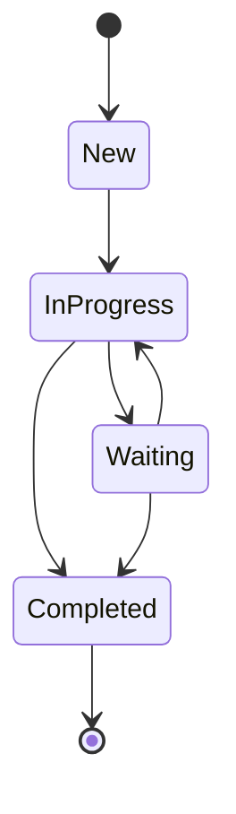
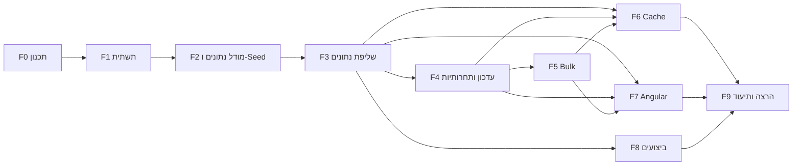
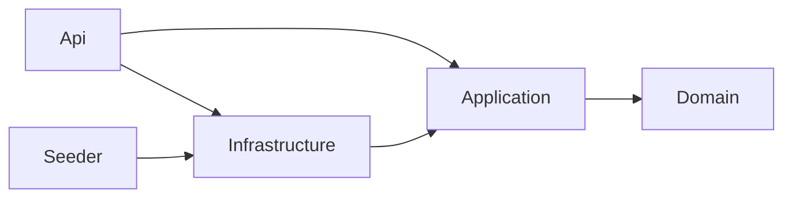

# Requests Management System

מערכת Full Stack לניהול פניות ובקשות המתקבלות מארגונים ומעסיקים.
המערכת מיועדת לעבודה של מספר משתמשים במקביל מול כמות גדולה של פניות (100,000+), ומאפשרת לאתר, לסנן, למיין ולדפדף בפניות. כל הפעולות האלה מתבצעות בצד השרת. בנוסף אפשר לעדכן סטטוס עם הגנה מפני עדכונים מתחרים, לבצע עדכון מרובה (Bulk), לצפות בהיסטוריית שינויים ולצפות בנתונים מסכמים.

**טכנולוגיות:** ASP.NET Core 10 · EF Core 10 · SQL Server 2022 · Angular 20 · xUnit · Testcontainers · Docker

---

## תוכן עניינים

1. [סטטוס התקדמות](#סטטוס-התקדמות)
2. [אפיון המערכת](#אפיון-המערכת)
   - [מבנה פנייה](#מבנה-פנייה)
   - [מחזור חיים של פנייה - מעברי סטטוס](#מחזור-חיים-של-פנייה---מעברי-סטטוס)
   - [היסטוריית שינויים](#היסטוריית-שינויים)
   - [חוזה ה-API המתוכנן](#חוזה-ה-api-המתוכנן)
   - [קודי תשובה](#קודי-תשובה)
3. [תכנון עבודה וחלוקה למשימות](#תכנון-עבודה-וחלוקה-למשימות)
   - [מתודולוגיה](#מתודולוגיה)
   - [פירוק ל-Features, User Stories ו-Tasks](#פירוק-ל-features-user-stories-ו-tasks)
   - [סדר ביצוע ותלויות](#סדר-ביצוע-ותלויות)
   - [סיכום הערכת מאמץ](#סיכום-הערכת-מאמץ)
   - [מיפוי דרישות המבדק למשימות](#מיפוי-דרישות-המבדק-למשימות)
4. [החלטות טכנולוגיות ראשוניות](#החלטות-טכנולוגיות-ראשוניות)
5. [מבנה הפתרון](#מבנה-הפתרון)
   - [שכבות וכיווני תלות](#שכבות-וכיווני-תלות)
   - [קונבנציות ואיכות קוד](#קונבנציות-ואיכות-קוד)
6. [בסיס הנתונים](#בסיס-הנתונים)
   - [סכמה](#סכמה)
   - [אינדקסים](#אינדקסים)
   - [נתוני בדיקה (Seed)](#נתוני-בדיקה-seed)
7. [הרצה מקומית](#הרצה-מקומית)

---

## סטטוס התקדמות

כל שלב מסתיים בקומיט נפרד ובעדכון של המסמך הזה.

| שלב | תוכן | סטטוס |
|---|---|---|
| 0 | תכנון, אפיון וחלוקה למשימות | הושלם |
| 1 | תשתית Solution וקונבנציות | הושלם |
| 2 | מודל נתונים, אינדקסים ו-Seed של 100K רשומות | הושלם |
| 3 | API לשליפת נתונים ו-Aggregations | מתוכנן |
| 4 | עדכון סטטוס, Concurrency והיסטוריית שינויים | מתוכנן |
| 5 | עדכון מרובה (Bulk) | מתוכנן |
| 6 | Cache | מתוכנן |
| 7 | צד לקוח (Angular) | מתוכנן |
| 8 | מדידת ביצועים | מתוכנן |
| 9 | היערכות להרצה ותיעוד סופי | מתוכנן |

---

## אפיון המערכת

### מבנה פנייה

| שדה | טיפוס | הערות |
|---|---|---|
| `Id` | `int` | מזהה ייחודי (Identity, מפתח ראשי Clustered) |
| `Title` | `nvarchar(200)` | כותרת הפנייה, חובה |
| `OrganizationName` | `nvarchar(150)` | שם הארגון או העסק, חובה |
| `Status` | `tinyint` (enum) | `New`, `InProgress`, `Waiting`, `Completed` |
| `Priority` | `tinyint` (enum) | `Low`, `Medium`, `High` |
| `AssignedTo` | `nvarchar(100)` | מזהה או שם המטפל, יכול להיות ריק |
| `CreatedAt` | `datetime2` | תאריך יצירה (UTC) |
| `UpdatedAt` | `datetime2` | תאריך עדכון אחרון (UTC), מתעדכן בכל שינוי |
| `RowVersion` | `rowversion` | מנוהל על ידי SQL Server ומשמש לזיהוי עדכון מתחרה |

ה-enums נשמרים כמספרים: זה חוסך מקום באינדקסים ומייעל השוואות. ב-API הם נחשפים כמחרוזות קריאות.

### מחזור חיים של פנייה - מעברי סטטוס

מעברי הסטטוס מוגדרים במפורש כמכונת מצבים בשכבת ה-Domain. מעבר שאינו מופיע בטבלה נדחה עם שגיאת Validation ברורה.



| מסטטוס | סטטוסים מותרים |
|---|---|
| `New` | `InProgress` |
| `InProgress` | `Waiting`, `Completed` |
| `Waiting` | `InProgress`, `Completed` |
| `Completed` | אין, זהו סטטוס סופי |

הנימוק: פנייה חדשה חייבת לעבור טיפול לפני שהיא מסומנת כהושלמה, ופנייה שהושלמה לא נפתחת מחדש. פתיחה מחדש היא תהליך עסקי נפרד שאינו חלק מהאפיון.

### היסטוריית שינויים

לכל שינוי סטטוס נשמרת רשומת Audit בטבלה `RequestStatusHistory`:

| שדה | תיאור |
|---|---|
| `Id` | מזהה רשומה |
| `RequestId` | מפתח זר לפנייה |
| `PreviousStatus` | הסטטוס לפני השינוי |
| `NewStatus` | הסטטוס אחרי השינוי |
| `ChangedAt` | מועד השינוי (UTC) |
| `ChangedBy` | מזהה המשתמש שביצע את השינוי |

רשומת ה-Audit נכתבת **באותה טרנזקציה** של עדכון הפנייה. לכן לא ייתכן מצב של שינוי בלי היסטוריה, וגם לא מצב של היסטוריה בלי שינוי.

### חוזה ה-API המתוכנן

| Method | Route | תיאור |
|---|---|---|
| `GET` | `/api/requests` | שליפת פניות עם דפדוף, סינון, חיפוש ומיון בצד השרת |
| `GET` | `/api/requests/{id}` | שליפת פנייה בודדת |
| `GET` | `/api/requests/summary` | נתונים מסכמים: התפלגות לפי סטטוס ולפי עדיפות (נשמר ב-Cache) |
| `PATCH` | `/api/requests/{id}/status` | עדכון סטטוס של פנייה בודדת |
| `PATCH` | `/api/requests/status` | עדכון סטטוס מרובה, עד 100 פניות |
| `GET` | `/api/requests/{id}/history` | היסטוריית שינויי הסטטוס של פנייה |

**פרמטרים לשליפה (`GET /api/requests`):**

| פרמטר | תיאור |
|---|---|
| `page`, `pageSize` | דפדוף. ל-`pageSize` יש ערך מקסימלי שמוגדר בקונפיגורציה |
| `status`, `priority` | סינון. אפשר להעביר כמה ערכים |
| `organizationName`, `assignedTo` | סינון לפי ערך מדויק |
| `createdFrom`, `createdTo` | טווח תאריכי יצירה |
| `search` | חיפוש טקסטואלי ב-`Title` וב-`OrganizationName` |
| `sortBy`, `sortDirection` | מיון לפי `CreatedAt`, `UpdatedAt`, `Priority`, `Status`, `Title` או `OrganizationName`, בכיוון `Asc` או `Desc` |

**זיהוי המשתמש המבצע:** לא נדרש מנגנון הזדהות, ולכן המשתמש מזוהה באמצעות Header ‏`X-User-Id`. הקריאה של ה-Header עטופה ב-`ICurrentUserProvider`, כך שאפשר להחליף אותה ב-Claims של JWT בלי לשנות את הלוגיקה העסקית.

**הגנה מפני עדכון מתחרה:** כל פנייה מוחזרת ללקוח עם שדה `version`, שהוא ה-`RowVersion` מקודד ב-Base64. בבקשת עדכון הלקוח מחזיר את הגרסה שבידיו, והעדכון מתבצע רק אם הגרסה ב-DB זהה לה.

### קודי תשובה

| מצב | קוד |
|---|---|
| הצלחה | `200 OK` |
| פרמטרים לא תקינים או סטטוס לא קיים | `400 Bad Request` (`ValidationProblemDetails`) |
| פנייה לא קיימת | `404 Not Found` |
| עדכון מתחרה: הגרסה שנשלחה אינה עדכנית | `409 Conflict` |
| מעבר סטטוס אסור | `422 Unprocessable Entity` |
| שגיאה לא צפויה | `500 Internal Server Error` (ללא חשיפת פרטים פנימיים) |

כל השגיאות מוחזרות בפורמט ProblemDetails אחיד (RFC 9457).
הקוד `409` שמור לתחרותיות בלבד, כדי שהלקוח יוכל להגיב לו באופן חד-משמעי: לטעון את הגרסה העדכנית ולהציע למשתמש לנסות שוב.

---

## תכנון עבודה וחלוקה למשימות

### מתודולוגיה

האפיון פורק להיררכיה של שלוש רמות:

- **Feature:** יחידת ערך עסקית או טכנית, שממופה לסעיף או לסעיפים במבדק.
- **User Story:** הצורך מנקודת מבט המשתמש או הבודק.
- **Task:** יחידת עבודה ברת ביצוע, עם תוצר מוגדר והערכת מאמץ בדקות.

כל Feature מסתיים בקומיט ייעודי שכולל את הקוד, את הבדיקות ואת עדכון התיעוד שלו. הבדיקות האוטומטיות נכתבות יחד עם הפיצ'ר ולא בסוף הפרויקט, כך שכל שלב נמסר כשהוא כבר מאומת.

### פירוק ל-Features, User Stories ו-Tasks

#### F0 - תכנון ואפיון
> **US0:** כבודק/ת, אני רוצה לראות כיצד האפיון תורגם לתוכנית עבודה מסודרת.

| ID | משימה | מה נדרש | תוצר | תלוי ב- | הערכה |
|---|---|---|---|---|---|
| T0.1 | ניתוח דרישות ואפיון | ניתוח המבדק, הגדרת מודל הפנייה, מעברי סטטוס, חוזה API וקודי תשובה | פרק "אפיון המערכת" | - | 20 דק' |
| T0.2 | פירוק למשימות | חלוקה ל-Features, Stories ו-Tasks, תלויות, סדר ביצוע והערכות | פרק "תכנון עבודה" | T0.1 | 15 דק' |
| T0.3 | החלטות טכנולוגיות | בחירת טכנולוגיות ובסיס נתונים, ונימוק | פרק "החלטות טכנולוגיות" | T0.1 | 10 דק' |

#### F1 - תשתית Solution
> **US1:** כמפתח/ת, אני רוצה מבנה פרויקט ברור עם קונבנציות אחידות, כדי שהקוד יהיה קריא וקל לתחזוקה.

| ID | משימה | מה נדרש | תוצר | תלוי ב- | הערכה |
|---|---|---|---|---|---|
| T1.1 | מבנה Solution | פרויקטים לשכבות Domain, Application, Infrastructure ו-Api, פרויקטי בדיקות ו-Seeder | Solution שנבנה בהצלחה | T0.3 | 10 דק' |
| T1.2 | קונבנציות ו-Build | `.editorconfig`, `Directory.Build.props`, Central Package Management, Nullable ו-Warnings as Errors | קבצי תצורה משותפים | T1.1 | 10 דק' |
| T1.3 | סביבת DB מקומית | `docker-compose` עם SQL Server וקובץ `.env.example` | DB שעולה בפקודה אחת | T1.1 | 10 דק' |

#### F2 - מודל נתונים ו-Seed
> **US2:** כבודק/ת, אני רוצה בסיס נתונים עם 100,000 פניות לפחות, שאפשר ליצור מחדש בכל עת, כדי לבחון את המערכת בתנאים מציאותיים.

| ID | משימה | מה נדרש | תוצר | תלוי ב- | הערכה |
|---|---|---|---|---|---|
| T2.1 | ישויות Domain | ישויות `Request` ו-`RequestStatusHistory`, enums ומדיניות מעברי סטטוס | שכבת Domain | T1.1 | 20 דק' |
| T2.2 | תצורת EF ואינדקסים | Fluent Configuration, ‏`RowVersion` כ-Concurrency Token, אינדקסים לתרחישי הסינון ו-Migration | Migration ראשוני | T2.1 | 25 דק' |
| T2.3 | Seeder | כלי Console שיוצר 100K רשומות דטרמיניסטיות באמצעות `SqlBulkCopy`, עם אפשרות איפוס ויצירה חוזרת | `tools/RequestsManagement.Seeder` | T2.2 | 25 דק' |

#### F3 - שליפת נתונים
> **US3:** כמשתמש/ת, אני רוצה לאתר פניות באמצעות חיפוש, סינון משולב, מיון ודפדוף, ולראות נתונים מסכמים, בלי שכל הנתונים יועברו אליי.

| ID | משימה | מה נדרש | תוצר | תלוי ב- | הערכה |
|---|---|---|---|---|---|
| T3.1 | חוזה שאילתה ו-Validation | אובייקט פרמטרים, הגבלת `PageSize` מקונפיגורציה, ולידציה של טווח תאריכים, שדה מיון וכיוון מיון | `RequestQueryParameters` עם Validator | T2.2 | 15 דק' |
| T3.2 | שאילתת סינון ומיון | בניית `IQueryable` עם סינון משולב, חיפוש, מיון והטלה (Projection) ל-DTO. כל הפעולות מתבצעות ב-DB, עם `AsNoTracking` ו-`CancellationToken` | `RequestQueryService` | T3.1 | 30 דק' |
| T3.3 | תשובת דפדוף | מודל `PagedResult<T>` הכולל `TotalCount` | תשובה אחידה לדפדוף | T3.2 | 10 דק' |
| T3.4 | Aggregations | התפלגות לפי סטטוס ולפי עדיפות באמצעות `GROUP BY` ב-DB | `GET /api/requests/summary` | T2.2 | 15 דק' |
| T3.5 | טיפול גלובלי בשגיאות ו-Logging | `IExceptionHandler`, ProblemDetails ולוגים מובנים ללא מידע רגיש | Middleware של שגיאות | T1.1 | 20 דק' |
| T3.6 | תשתית Integration Tests | `WebApplicationFactory` עם Testcontainers (SQL Server), ובדיקת שליפה וסינון | בדיקות שליפה ו-Validation | T3.2 | 30 דק' |

#### F4 - עדכון סטטוס, תחרותיות והיסטוריה
> **US4.1:** כמשתמש/ת, אני רוצה לעדכן סטטוס של פנייה ולקבל הודעה ברורה כאשר מישהו אחר עדכן אותה לפניי.
>
> **US4.2:** כמשתמש/ת, אני רוצה לראות מי שינה את סטטוס הפנייה ומתי.

| ID | משימה | מה נדרש | תוצר | תלוי ב- | הערכה |
|---|---|---|---|---|---|
| T4.1 | Endpoint לעדכון סטטוס | בדיקת קיום (404), ולידציה של הסטטוס (400) ושל המעבר (422) | `PATCH /api/requests/{id}/status` | T3.5 | 25 דק' |
| T4.2 | Optimistic Concurrency | השוואת הגרסה שנשלחה ל-`RowVersion` ב-DB, החזרת 409 עם הגרסה העדכנית ועדכון עקבי של `UpdatedAt` | מניעת Lost Update | T4.1 | 15 דק' |
| T4.3 | כתיבת Audit | רשומת היסטוריה באותה טרנזקציה של העדכון | טבלת `RequestStatusHistory` מתעדכנת | T4.1 | 15 דק' |
| T4.4 | Endpoint להיסטוריה | שליפת ההיסטוריה של פנייה בסדר כרונולוגי | `GET /api/requests/{id}/history` | T4.3 | 10 דק' |
| T4.5 | בדיקות | בדיקות יחידה למעברי סטטוס, ובדיקת אינטגרציה עם שני עדכונים מקביליים שבה בדיוק אחד מצליח והשני מקבל 409 | בדיקות Concurrency ו-Validation | T4.2 | 35 דק' |

#### F5 - עדכון מרובה (Bulk)
> **US5:** כמשתמש/ת, אני רוצה לעדכן סטטוס של מספר פניות בפעולה אחת, ולדעת בדיוק אילו עודכנו ואילו נכשלו ומדוע.

| ID | משימה | מה נדרש | תוצר | תלוי ב- | הערכה |
|---|---|---|---|---|---|
| T5.1 | חוזה Bulk | עד 100 פריטים לבקשה (מקונפיגורציה), ללא כפילויות, ותשובה עם תוצאה לכל פריט וסיכום | מודלי בקשה ותשובה | T4.2 | 10 דק' |
| T5.2 | מימוש Partial Success | טעינת כל הפניות בשאילתה אחת, עדכון כל פנייה בנפרד יחד עם ה-Audit שלה, וסיווג התוצאה: `Updated`, `NotFound`, `Conflict` או `InvalidTransition` | `PATCH /api/requests/status` | T5.1 | 30 דק' |
| T5.3 | בדיקות | תרחיש מעורב: פניות תקינות, פניות שאינן קיימות ופניות עם התנגשות | בדיקת אינטגרציה ל-Bulk | T5.2 | 20 דק' |

#### F6 - Cache
> **US6:** כמשתמש/ת, אני רוצה שהנתונים המסכמים ייטענו מהר, אבל לא יהיו מיושנים אחרי עדכון.

| ID | משימה | מה נדרש | תוצר | תלוי ב- | הערכה |
|---|---|---|---|---|---|
| T6.1 | Cache לנתונים המסכמים | `HybridCache` עם Expiration שמוגדר בקונפיגורציה | שליפה מה-Cache | T3.4 | 15 דק' |
| T6.2 | Invalidation | ניקוי לפי Tag לאחר עדכון בודד או עדכון מרובה | הנתונים המסכמים מתעדכנים מיד | T4.2, T5.2 | 10 דק' |
| T6.3 | בדיקה ותיעוד Scale-out | בדיקה שהנתון המסכם מתעדכן לאחר שינוי, ותיאור ההתאמה לסביבה מרובת מופעים | בדיקה ותיעוד | T6.2 | 15 דק' |

#### F7 - צד לקוח (Angular)
> **US7:** כמשתמש/ת, אני רוצה ממשק שבו אוכל לחפש, לסנן, למיין ולדפדף בפניות, לעדכן סטטוס, לראות נתונים מסכמים ולצפות בהיסטוריה.

| ID | משימה | מה נדרש | תוצר | תלוי ב- | הערכה |
|---|---|---|---|---|---|
| T7.1 | הקמת פרויקט ושכבת API | Standalone Components, ‏Environments, מודלים טיפוסיים ו-`RequestsApiService` | שכבת גישה לשרת | T3.3 | 20 דק' |
| T7.2 | ניהול State | Facade Service עם RxJS: ‏`debounceTime`, `distinctUntilChanged` ו-`switchMap` לביטול בקשות קודמות | `RequestsStore` | T7.1 | 30 דק' |
| T7.3 | רשימת פניות | טבלה עם חיפוש, סינון, מיון ודפדוף, שכולם מבוצעים בצד השרת | `RequestsListComponent` | T7.2 | 40 דק' |
| T7.4 | מצבי UI | מצבי Loading, ‏Empty ו-Error | רכיבי מצב | T7.3 | 10 דק' |
| T7.5 | עדכון סטטוס | בחירת סטטוס מותר בלבד, וטיפול ב-409: הודעה ברורה וטעינה מחדש | `StatusUpdateComponent` | T7.3, T4.2 | 25 דק' |
| T7.6 | נתונים מסכמים | הצגת התפלגויות | `RequestsSummaryComponent` | T7.1, T3.4 | 15 דק' |
| T7.7 | היסטוריית שינויים | הצגת ההיסטוריה של פנייה | `RequestHistoryComponent` | T7.1, T4.4 | 20 דק' |
| T7.8 | עדכון מרובה ב-UI | בחירת מספר פניות והצגת תוצאה לכל פנייה | פעולת Bulk בטבלה | T7.3, T5.2 | 20 דק' |

#### F8 - ביצועים
> **US8:** כבודק/ת, אני רוצה לראות הוכחה מדידה שהשאילתות המרכזיות יעילות על 100K רשומות.

| ID | משימה | מה נדרש | תוצר | תלוי ב- | הערכה |
|---|---|---|---|---|---|
| T8.1 | מדידה | Execution Plan ו-`SET STATISTICS IO, TIME` לשתי פעולות מרכזיות, לפני הוספת האינדקסים ואחריה | קבצים ב-`docs/performance` | T2.3, T3.2, T3.4 | 40 דק' |
| T8.2 | ניתוח ותיעוד | פירוט האינדקסים והסיבה לכל אחד, זיהוי Bottleneck והצעת שיפור | פרק ביצועים ב-README | T8.1 | 20 דק' |

#### F9 - היערכות להרצה ותיעוד
> **US9:** כבודק/ת, אני רוצה להריץ את כל המערכת בקלות ולהבין את מבנה הפתרון ואת ההחלטות שהתקבלו.

| ID | משימה | מה נדרש | תוצר | תלוי ב- | הערכה |
|---|---|---|---|---|---|
| T9.1 | Docker | Dockerfile ל-API ול-Web ו-`docker-compose` מלא: DB, ‏Migration, ‏Seed, ‏API ו-Web | הרצה בפקודה אחת | F1–F7 | 25 דק' |
| T9.2 | תיעוד סופי | הוראות הרצה, גרסאות, מבנה, Concurrency ו-Bulk, ‏Cache, החלטות וחלופות, מגבלה ושיפור, ושימוש ב-AI | README שלם | הכול | 35 דק' |

### סדר ביצוע ותלויות



**הנתיב הקריטי:** F0 ← F1 ← F2 ← F3 ← F4 ← F5 ← F7 ← F9.

F8 (ביצועים) יכול להתבצע במקביל ל-F4 עד F7, כי הוא תלוי רק במודל הנתונים ובשאילתות השליפה. F6 (Cache) מגיע אחרי F5, כי ה-Invalidation צריך לכסות גם את העדכון המרובה.

### סיכום הערכת מאמץ

| Feature | הערכה |
|---|---|
| F0 - תכנון ואפיון | 45 דק' |
| F1 - תשתית Solution | 30 דק' |
| F2 - מודל נתונים ו-Seed | 1 ש' 10 דק' |
| F3 - שליפת נתונים | 2 ש' |
| F4 - עדכון סטטוס, תחרותיות והיסטוריה | 1 ש' 40 דק' |
| F5 - עדכון מרובה | 1 ש' |
| F6 - Cache | 40 דק' |
| F7 - צד לקוח | 3 ש' |
| F8 - ביצועים | 1 ש' |
| F9 - היערכות להרצה ותיעוד | 1 ש' |
| **סה"כ** | **12 ש' 45 דק'** |

### מיפוי דרישות המבדק למשימות

| סעיף במבדק | דרישה | משימות |
|---|---|---|
| מבנה פנייה | שדות הפנייה ו-RowVersion | T2.1, T2.2 |
| מבנה פנייה | 100,000 רשומות לפחות ויצירה חוזרת | T2.3 |
| 1 | Pagination בצד השרת | T3.2, T3.3 |
| 1 | סינון משולב: Status, Priority, OrganizationName, AssignedTo וטווח תאריכים | T3.1, T3.2 |
| 1 | חיפוש טקסטואלי ב-Title וב-OrganizationName | T3.2 |
| 1 | מיון לפי שלושה שדות לפחות, Asc ו-Desc | T3.1, T3.2 |
| 1 | שני Aggregations לפחות | T3.4 |
| 1 | הגבלת Page Size ו-Validation | T3.1 |
| 1 | CancellationToken | T3.2, T3.4 |
| 1 | החזרת DTOs | T3.2 |
| 1 | תיעוד: מניעת טעינה לזיכרון ותמיכת האינדקסים | T3.2, T8.2 |
| 2 | 404 לפנייה שאינה קיימת | T4.1 |
| 2 | Validation לסטטוס ולמעבר | T4.1 |
| 2 | Optimistic Concurrency ו-409 | T4.2, T4.5 |
| 2 | עדכון עקבי של UpdatedAt ו-RowVersion ומניעת Lost Update | T4.2 |
| 3 | Audit לכל שינוי סטטוס | T4.3 |
| 3 | Endpoint להיסטוריה | T4.4 |
| 4 | Bulk עד 100 פניות | T5.1, T5.2 |
| 4 | הגדרה, נימוק ותיעוד של ההתנהגות | T5.1, T9.2 |
| 5 | חיפוש, סינון, מיון ודפדוף בצד השרת | T7.2, T7.3 |
| 5 | Debounce וביטול בקשות קודמות | T7.2 |
| 5 | מצבי Loading, Empty ו-Error | T7.4 |
| 5 | עדכון סטטוס וטיפול ב-409 | T7.5, T7.8 |
| 5 | הצגת Aggregations | T7.6 |
| 5 | היסטוריית שינויים | T7.7 |
| 5 | הפרדה בין Components ל-Services | T7.1, T7.2 |
| 6 | מדידה של שתי פעולות מרכזיות (Execution Plan) | T8.1 |
| 6 | פירוט האינדקסים והסיבה | T2.2, T8.2 |
| 6 | Bottleneck והצעת שיפור | T8.2 |
| 6 | ללא טעינה מלאה לפני Pagination או Filtering | T3.2 |
| 7 | Cache עם Expiration | T6.1 |
| 7 | Invalidation | T6.2 |
| 7 | נימוק ותיאור Scale-out | T6.3 |
| 8 | ארבע בדיקות לפחות, מהן אחת Integration | T3.6, T4.5, T5.3, T6.3 |
| 9 | תכנון עבודה וחלוקה למשימות | F0 (המסמך הזה) |
| 10 | איכות קוד: מבנה, DI, Async, Error Handling, Validation ו-Logging | T1.1, T1.2, T3.5 |
| 11 | תיעוד הפתרון | T9.2 |

---

## החלטות טכנולוגיות ראשוניות

| תחום | בחירה | נימוק |
|---|---|---|
| Backend | ASP.NET Core 10 Web API | גרסת LTS עדכנית. כוללת `HybridCache` עם Invalidation לפי Tags ו-`IExceptionHandler` מובנה |
| בסיס נתונים | SQL Server 2022 עם EF Core 10 | ‏`rowversion` נותן Optimistic Concurrency מובנה ברמת ה-DB, כלי Execution Plan לבחינת ביצועים, ו-`SqlBulkCopy` ל-Seed מהיר |
| ארכיטקטורה | שכבות Domain, Application, Infrastructure ו-Api | הפרדת אחריות ברורה ובדיקוּת גבוהה, בלי שכבות מיותרות כמו MediatR או Repository גנרי מעל EF Core |
| Validation | FluentValidation | כללים מוצהרים ובני-בדיקה, שמוחזרים כ-`ValidationProblemDetails` |
| Frontend | Angular 20 | Standalone Components ו-Signals לתצוגה, ו-RxJS לזרימת בקשות אסינכרונית |
| בדיקות | xUnit, ‏WebApplicationFactory ו-Testcontainers | בדיקות האינטגרציה רצות מול SQL Server אמיתי, כי רק כך נבדקת התנהגות `rowversion` בפועל |
| הרצה | Docker Compose | הרצה מלאה של המערכת בפקודה אחת |

פירוט החלטות נוספות והחלופות שנשקלו יתווסף בשלבים הבאים, יחד עם המימוש.

---

## מבנה הפתרון

```
requests-management-system/
├── src/
│   ├── RequestsManagement.Domain/          ישויות, enums וכללים עסקיים
│   ├── RequestsManagement.Application/     Use cases, DTOs, Validation וממשקים
│   ├── RequestsManagement.Infrastructure/  EF Core, SQL Server, Cache ומימושי הממשקים
│   └── RequestsManagement.Api/             Controllers, טיפול בשגיאות ותצורה
├── tools/
│   └── RequestsManagement.Seeder/          יצירה חוזרת של נתוני בדיקה
├── tests/
│   ├── RequestsManagement.UnitTests/       בדיקות לוגיקה עסקית ו-Validation
│   └── RequestsManagement.IntegrationTests/ בדיקות API מול SQL Server אמיתי
├── Directory.Build.props                   הגדרות Build משותפות לכל הפרויקטים
├── Directory.Packages.props                ניהול מרוכז של גרסאות חבילות
├── global.json                             נעילת גרסת ה-SDK ו-Test Runner
├── dotnet-tools.json                       כלים מקומיים (dotnet-ef)
├── .editorconfig                           קונבנציות קוד
└── docker-compose.yml                      סביבת הרצה מקומית
```

### שכבות וכיווני תלות



| שכבה | אחריות | מה אסור בה |
|---|---|---|
| Domain | מודל הפנייה, מעברי סטטוס וכללים עסקיים טהורים | תלות בתשתית, ב-EF Core או ב-ASP.NET |
| Application | תרחישי השימוש, חוזי DTO, Validation וממשקים לתשתית | גישה ישירה ל-DB או ל-HTTP |
| Infrastructure | מימוש הגישה לנתונים, Cache ושירותים חיצוניים | לוגיקה עסקית |
| Api | חשיפת HTTP, מיפוי שגיאות לקודי תשובה, תצורה ו-DI | לוגיקה עסקית או שאילתות |

התלויות מצביעות פנימה, אל ה-Domain. כך הלוגיקה העסקית נבדקת בבדיקות יחידה בלי בסיס נתונים, ואפשר להחליף את מימוש התשתית בלי לגעת בה.

### קונבנציות ואיכות קוד

- **`Directory.Build.props`:** ‏`net10.0`, ‏Nullable Reference Types ו-`TreatWarningsAsErrors`. ‏Roslyn Analyzers מופעלים ברמת `latest-recommended`, וכללי הסגנון נאכפים כבר בזמן Build (`EnforceCodeStyleInBuild`).
- **`Directory.Packages.props`:** כל גרסאות החבילות מנוהלות במקום אחד (Central Package Management). כך לא ייתכנו שתי גרסאות שונות של אותה חבילה בפרויקטים שונים. בנוסף מופעל Transitive Pinning, שמאפשר לקבע גרסה מתוקנת גם לחבילה עקיפה. כך תוקנה פגיעות אבטחה ידועה ב-`System.Security.Cryptography.Pkcs`, שנגררת דרך SqlClient.
- **`.editorconfig`:** כללי שמות (`_camelCase` לשדות פרטיים, סיומת `Async` למתודות אסינכרוניות, קידומת `I` לממשקים), ‏File-scoped namespaces, סוגריים מסולסלים חובה ופורמט אחיד לקבצי C# ו-TypeScript.
- **`global.json`:** הפרויקט נבנה עם ‎.NET SDK 10. גרסאות Feature חדשות יותר מתקבלות אוטומטית. הבדיקות רצות על Microsoft.Testing.Platform, שהוא ה-Runner המומלץ ב-.NET 10.
- **קוד שנוצר אוטומטית:** קבצי ה-Migrations מסומנים ב-`.editorconfig` כ-`generated_code`, ולכן ה-Analyzers לא חלים עליהם.
- **קונפיגורציה:** ערכים משתנים כמו סיסמאות ופורטים מגיעים מקובץ `.env` שאינו נשמר ב-Git. הקובץ `.env.example` מתעד את המשתנים הנדרשים.
- **קומיטים:** לפי [Conventional Commits](https://www.conventionalcommits.org/), קומיט אחד לכל שלב בתוכנית העבודה.

---

## בסיס הנתונים

### סכמה

הסכמה מוגדרת ב-EF Core באמצעות Fluent Configuration (`IEntityTypeConfiguration`), ונוצרת באמצעות Migrations. מגבלות האורך של השדות מוגדרות פעם אחת ב-`RequestConstraints` שב-Domain, ומשמשות גם את תצורת ה-DB וגם את ה-Validation.

| טבלה | הערות |
|---|---|
| `Requests` | מפתח ראשי Clustered על `Id` (Identity). ה-enums נשמרים כ-`tinyint`. ‏`RowVersion` מוגדר כ-`rowversion`, ולכן SQL Server מעדכן אותו אוטומטית בכל שינוי בשורה |
| `RequestStatusHistory` | מפתח ראשי `bigint`, כי טבלת היסטוריה גדלה מהר יותר מטבלת הפניות. ‏FK לפנייה עם `ON DELETE CASCADE` |

הישות `Request` חושפת רק Setters פרטיים. שינוי סטטוס אפשרי רק דרך `ChangeStatus`, שבודק שהמעבר מותר, מעדכן את `UpdatedAt` ומחזיר את רשומת ההיסטוריה. כך אין דרך לשנות סטטוס בלי לייצר Audit.

### אינדקסים

ברירת המחדל של המיון היא `CreatedAt DESC`, ולכן כל אינדקס סינון כולל את `CreatedAt` בסדר יורד כעמודה שנייה. כך SQL Server מסנן ומחזיר את העמוד המבוקש לפי סדר האינדקס, בלי פעולת Sort נפרדת.

| אינדקס | תרחיש שהוא משרת |
|---|---|
| `IX_Requests_CreatedAt` (DESC) | רשימת ברירת המחדל וסינון לפי טווח תאריכים |
| `IX_Requests_Status_CreatedAt` | סינון לפי סטטוס, והתפלגות לפי סטטוס (Aggregation) |
| `IX_Requests_Priority_CreatedAt` | סינון לפי עדיפות, והתפלגות לפי עדיפות (Aggregation) |
| `IX_Requests_AssignedTo_CreatedAt` | "הפניות שלי": סינון לפי מטפל |
| `IX_Requests_OrganizationName_CreatedAt` | סינון לפי ארגון |
| `IX_RequestStatusHistory_RequestId_ChangedAt` | שליפת היסטוריה של פנייה בסדר כרונולוגי |

מספר האינדקסים מאוזן מול עלות הכתיבה. במערכת הזו יש הרבה יותר קריאות (חיפוש וסינון) מכתיבות (עדכוני סטטוס), ועדכון סטטוס משנה רק את האינדקס על `Status`.
מדידת ההשפעה של כל אינדקס באמצעות Execution Plans תתועד בשלב הביצועים.

### נתוני בדיקה (Seed)

הכלי `RequestsManagement.Seeder` הוא אפליקציית Console שאחראית גם על החלת ה-Migrations וגם על יצירת הנתונים:

1. אם התבקש איפוס (`Reset`), בסיס הנתונים נמחק ונוצר מחדש.
2. ה-Migrations מוחלות.
3. אם כבר קיימות פניות, הכלי מדלג על יצירת הנתונים. לכן אפשר להריץ אותו שוב ושוב בבטחה.
4. הפניות נוצרות באמצעות Bogus ומוכנסות ב-`SqlBulkCopy` במנות. ‏100,000 רשומות נוצרות בכ-20 שניות.

**החלטות:**
- **`SqlBulkCopy` במקום EF Core:** הכנסה של 100K ישויות דרך `SaveChanges` איטית בסדר גודל, וצורכת זיכרון רב בגלל ה-Change Tracker. שמות הטבלה והעמודות נקראים מתוך מודל ה-EF, ולכן לא מוגדרים פעמיים.
- **נתונים מציאותיים:** מאגר של 2,000 ארגונים ו-50 מטפלים, כך שסינון לפי ארגון או מטפל מחזיר כמות משמעותית של תוצאות. התפלגות הסטטוסים והעדיפויות משוקללת, תאריכי היצירה מפוזרים על פני שנתיים, ו-`UpdatedAt` תמיד אחרי `CreatedAt`. לפניות בסטטוס `New` אין מטפל.
- **Seed קבוע (`RandomSeed`):** אותו Seed מייצר את אותם ערכים בכל הרצה. התאריכים מחושבים יחסית למועד ההרצה, כדי שהנתונים יישארו עדכניים.
- **היסטוריה:** הכלי יוצר פניות בלבד. היסטוריית סטטוסים נרשמת רק עבור שינויים שבוצעו דרך המערכת, כך שכל רשומת Audit משקפת פעולה אמיתית.
- **הפרדה מה-API:** ה-API לא מחיל Migrations בעלייה. בסביבה עם כמה מופעי שרת, החלה מקבילית של Migrations עלולה להתנגש, ולכן זו אחריות של כלי נפרד שרץ פעם אחת לפני העלייה.

כל הפרמטרים מוגדרים בקובץ `appsettings.json` של הכלי, תחת `Seed`: ‏`RecordCount`, `BatchSize`, `RandomSeed`, `HistoryDays`, `OrganizationCount`, `AssigneeCount` ו-`Reset`. אפשר לדרוס כל אחד מהם משורת הפקודה.

---

## הרצה מקומית

### דרישות מקדימות

| כלי | גרסה |
|---|---|
| .NET SDK | 10.0 |
| Docker Desktop | 4.x ומעלה |
| Node.js | 22 LTS ומעלה (לצד הלקוח, משלב 7) |

### הקמת בסיס הנתונים

```bash
cp .env.example .env
docker compose up -d sqlserver
```

הפקודה מרימה SQL Server 2022 בפורט שמוגדר ב-`.env` (ברירת המחדל: `1433`). הנתונים נשמרים ב-Volume, כך שהם לא נמחקים כשהקונטיינר מופעל מחדש.

### יצירת הסכמה ונתוני הבדיקה

```bash
dotnet run --project tools/RequestsManagement.Seeder
```

יצירה מחדש של כל הנתונים מאפס:

```bash
dotnet run --project tools/RequestsManagement.Seeder -- --Seed:Reset=true
```

כמות רשומות שונה:

```bash
dotnet run --project tools/RequestsManagement.Seeder -- --Seed:Reset=true --Seed:RecordCount=250000
```

### בנייה ובדיקות

```bash
dotnet build RequestsManagement.slnx
dotnet test --solution RequestsManagement.slnx
```

### Migrations

```bash
dotnet tool restore
dotnet ef migrations add <MigrationName> --project src/RequestsManagement.Infrastructure --startup-project src/RequestsManagement.Api --output-dir Persistence/Migrations
```

הוראות להרצת ה-API וצד הלקוח יתווספו בשלבים הבאים.
